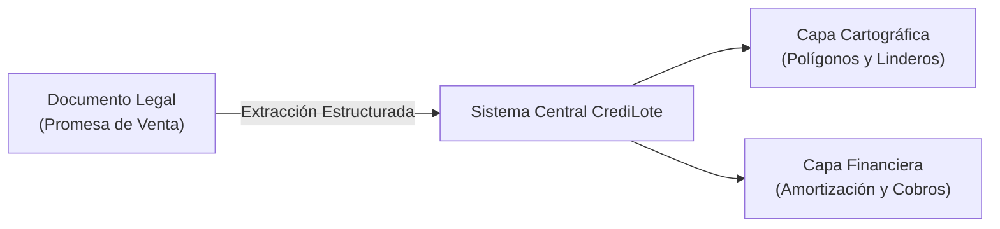

# 01.1 - Visión y Objetivos de CrediLote

> [!NOTE] Enfoque de Usuario
> En su fase inicial, la plataforma está diseñada exclusivamente para el Administrador / Desarrollador de la lotificación. No contempla portal público ni acceso a clientes en esta etapa, con el objetivo de maximizar la velocidad operativa y el control interno de cartera.

---

## 1. Declaración del Problema

La venta y financiamiento directo de terrenos y parcelas presenta deficiencias operativas comunes:

1. **Desarticulación Documental:** Las promesas de compraventa y contratos se conservan en soporte físico o en repositorios de archivos sin indexación, dificultando la trazabilidad de titulares por lote.
2. **Cálculos Financieros Manuales:** La liquidación y seguimiento de pagos en hojas de cálculo tradicionales genera inconsistencias en amortizaciones tras abonos parciales o renegociaciones de prima.
3. **Falta de Trazabilidad Geoespacial:** Ausencia de un sistema cartográfico centralizado que permita visualizar el área física vendida, linderos exactos, titularidad y disponibilidad de lotes colindantes.
4. **Seguimiento Ineficiente de Cobranza:** Dificultad para determinar anticipadamente vencimientos próximos o identificar con precisión clientes con cuotas en mora.

---

## 2. Propuesta de Valor

CrediLote centraliza tres capas operativas en un entorno administrativo unificado:

1. **Digitalización Inmediata:** Procesamiento de promesas de venta (PDF o imagen escaneada) mediante extracción automática de comprador, vendedor, precio pactado, prima y coordenadas de delimitación.
2. **Representación Cartográfica Directa:** Graficación automática del polígono del terreno en mapa georreferenciado, asociando la titularidad del comprador al área correspondiente.
3. **Generación Automatizada del Plan de Pagos:** Cálculo instantáneo de la tabla de amortización con base en la prima abonada y los plazos pactados.

---

## 3. Objetivos del Sistema

Cada criterio indica **cómo se mide**, para poder declararlo cumplido o no.

| Objetivo | Descripción | Criterio de Aceptación | Cómo se mide |
| :--- | :--- | :--- | :--- |
| **Digitalización Ágil** | Reducir el tiempo de registro de contratos de compraventa. | Mediana ≤ **60 s** desde la carga del archivo hasta la confirmación, con extracción automática. Con captura manual, ≤ **5 min**. | Cronometrar el registro de 5 contratos reales distintos. |
| **Precisión Cartográfica** | Renderizado geométrico confiable de los linderos. | En ≥ **95 %** de los lotes: error de cierre ≤ 1/1000 y diferencia de área ≤ 2 % frente al contrato (RN-G2, RN-G3). | Informe de lotes de un proyecto real con ambos indicadores. |
| **Exactitud Financiera** | Tablas de amortización y saldos sin errores. | Los tres sistemas reproducen **al centavo** los ejemplos de [[03.2 - Reglas de Negocio y Cálculos]] y toda tabla termina en saldo 0.00. | Tests unitarios automáticos del motor financiero. |
| **Control de Cartera** | Trazabilidad de saldos, cuotas y pagos. | **100 %** de los pagos tienen recibo, y la suma de recibos emitidos no anulados coincide al centavo con lo aplicado a las cuotas (invariantes de 03.1). | Verificación automática de invariantes sobre la base de datos. |
| **Integridad de Datos** | Ninguna pérdida de información. | Exportar y restaurar un respaldo reproduce la **misma cantidad de registros** por tabla y la misma suma de verificación. | Prueba de respaldo y restauración en otro navegador. |
| **Operación Intuitiva** | Uso sin experiencia en herramientas GIS ni contables. | Tras una demostración de 30 min, un administrador nuevo crea proyecto, lote, promesa y pago **sin ayuda en ≤ 15 min**. Registrar un pago toma **≤ 1 min**. | Prueba con al menos 2 usuarios que no participaron en el desarrollo. |

---

## 4. Alcance Operativo

### Fase Actual (Administración Central):
- Carga y visualización de promesas de venta en PDF o formato de imagen.
- Extracción asistida con validación humana en interfaz de pantalla dividida.
- Renderizado cartográfico con Leaflet (capas satelitales y vectoriales).
- Motor de cálculo de tablas de amortización (Francés, Alemán y Crédito Directo).
- Registro de cobranza, control de saldos y emisión de recibos imprimibles (o guardados como PDF desde el navegador).
- Inventario por proyectos, bloques y lotes.

### Extensiones Posteriores (Fase Secundaria):
- Consulta de estados de cuenta para clientes.
- Integración con pasarelas de pago electrónico.
- Firma electrónica avanzada de instrumentos de promesa de compraventa.

---

## 5. Contexto Regional y Marco Legal

CrediLote está diseñado para lotificaciones en **El Salvador** (decisión D4, ver [[ADR-004 - Contexto regional El Salvador]]).

| Aspecto | Convención |
| :--- | :--- |
| Moneda | Dólar estadounidense (USD). |
| Identificación de personas | DUI (`00000000-0`); para personas naturales también funciona como NIT. |
| Identificación de empresas | NIT (`0000-000000-000-0`). |
| Teléfono | `+503` seguido de 8 dígitos. |
| Superficie | m², con equivalencia en varas cuadradas (1 v² = 0.698737 m²). |
| División territorial | Departamento → municipio → distrito. |

### Normativa que afecta al sistema

> [!WARNING] Pendiente de validación con asesoría legal y contable
> La lista identifica qué revisar; no es una interpretación de las normas.

| Norma o entidad | Qué debe confirmarse | Afecta a |
| :--- | :--- | :--- |
| Ley Especial de Lotificaciones y Parcelaciones para Uso Habitacional | Requisitos del contrato, mora y efectos de la rescisión. | RN-C2, RN-L3, RN-L5 |
| Ley contra la Usura | Tasas máximas para intereses y recargos moratorios. | RN-F1, RN-C2 |
| Facturación electrónica (DTE), Ministerio de Hacienda | Si cada cobro requiere un documento tributario electrónico además del recibo interno. | RN-C3, [[02.5 - Clientes, Cobranza y Recibos]] |
| Normativa de protección de datos personales | Consentimiento y transferencia de datos a servicios externos. | [[01.4 - Seguridad y Protección de Datos]] |
| Centro Nacional de Registros (CNR) | Requisitos para escriturar e inscribir el inmueble al finiquitar. | RN-L4 |

---

Enlaces relacionados:
- Siguiente: [[01.2 - Arquitectura y Stack Tecnológico]]
- Módulo de Ingesta: [[02.1 - Ingesta y Procesamiento de Promesas de Venta]]
- Glosario: [[00.1 - Glosario]]
