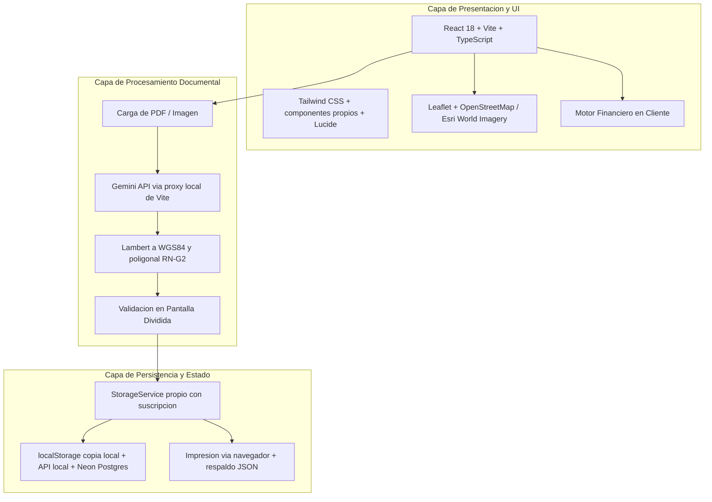

# 01.2 - Arquitectura y Stack Tecnológico

Este documento define la arquitectura técnica y las tecnologías de la plataforma **CrediLote**. Distingue entre lo **implementado** hoy en `src/` y el **objetivo** acordado cuando aún no se ha construido.



---

## 1. Stack Tecnológico

| Componente | Tecnología | Estado | Justificación Técnica |
| :--- | :--- | :--- | :--- |
| **Framework Base** | React 18 + Vite 6 + TypeScript 5 | ✅ Implementado | Tipado estático para estructuras financieras y cartográficas, compilación veloz. |
| **Estilos y UI** | Tailwind CSS 3 + componentes propios (`src/shared/components/ui/`) | ✅ Implementado | Componentes inspirados en los patrones de Saas UI sin depender de Chakra UI. Evita colisiones de CSS y dependencias pesadas. Ver [[01.3 - Sistema de Diseño y UI]]. |
| **Utilidades de clases** | `clsx` + `tailwind-merge` | ✅ Implementado | Composición segura de clases condicionales en componentes. |
| **Iconografía** | Lucide React | ✅ Implementado | Conjunto de iconos limpio y consistente. |
| **Motor Cartográfico** | Leaflet 1.9 (API directa, sin React-Leaflet) + OpenStreetMap / Esri World Imagery | ✅ Implementado | Biblioteca ligera, sin costes por consumo de API, soporte de polígonos y etiquetas. |
| **Estado de la aplicación** | `StorageService` propio (patrón *observer* con `subscribe`) | ✅ Implementado | Estado centralizado simple, sin librerías externas. |
| **Persistencia** | **Neon Postgres** vía API local (`server/api.ts`, `server/db.ts`); estado como documento JSONB con versión e historial | ✅ Implementado | Respaldo automático, uso desde varios equipos; la conexión vive solo en el servidor. Ver [[ADR-013 - Persistencia en Neon Postgres y Neon Storage\|ADR-013]]. |
| **Copia local** | `localStorage` (caché y trabajo sin conexión) | ✅ Implementado | La app sigue funcionando sin conexión y sincroniza al volver. |
| **Documentos** | **Neon Storage** (compatible con S3, bucket `docs00ventas`) vía API local | ✅ Implementado (falta conectarlo en pantalla, nota 04.4) | PDF e imágenes de las promesas. |
| **Extracción documental** | Google Gemini (`contractExtractor.ts`) a través del **proxy local de Vite** (`/api/gemini`) | ✅ Implementado | Interpreta escrituras notariales salvadoreñas (cantidades en letras, tramos). La clave `GEMINI_API_KEY` se queda en el servidor de desarrollo. Ver [[ADR-010 - Extracción documental con Google Gemini API y conversión geodésica\|ADR-010]]. |
| **Geodesia** | `geoElSalvador.ts`: Lambert El Salvador → WGS84, poligonal por rumbos, cierre y área | ✅ Implementado | Reglas RN-G1 a RN-G3 de [[03.2 - Reglas de Negocio y Cálculos]]. |
| **Pruebas automáticas** | Vitest (`npm test`) | ✅ Implementado | Geodesia (incluye una escritura real de 22 tramos, anonimizada) y validaciones de DUI/NIT/teléfono. |
| **Recibos y reportes** | Impresión del navegador (`window.print`) con estilos `@media print` | ✅ Implementado | Sin dependencias; el usuario puede "Guardar como PDF". |
| **Respaldo de datos** | Exportación / importación JSON | 🔜 Pendiente | Crítico por guardarse los datos solo en el navegador. |

> [!NOTE] Leyenda de estados
> ✅ Implementado · ⚠️ Implementado de forma temporal o simulada · 🔜 Pendiente

---

## 2. Estructura del Código

```
src/
├── app/                  # AppShell, Sidebar, Header, App (navegación por pestañas)
├── modules/
│   ├── dashboard/        # 02.6 - Dashboard
│   ├── cartography/      # 02.2 - Mapa y polígonos
│   ├── contracts/        # 02.1 - Ingesta de promesas de venta
│   │   ├── components/   # DescripcionTecnica.tsx (tabla de tramos, avisos, mini mapa)
│   │   └── services/     # contractExtractor.ts (Gemini vía proxy)
│   ├── finance/          # 02.3 - Tablas de amortización y simulador
│   │   └── engine/       # amortization.ts (lógica pura, sin UI)
│   ├── payments/         # 02.5 - Cobranza y recibos
│   └── inventory/        # 02.4 - Inventario de lotes
├── shared/
│   ├── components/ui/    # Badge, Button, Card, DataGrid, Drawer, MetricCard, Modal, PropertyList
│   ├── services/         # storage.ts (estado + persistencia)
│   ├── types/            # Tipos del dominio (ver 03.1)
│   └── utils/            # formatters.ts, geoElSalvador.ts, validaciones.ts (+ *.test.ts)
└── mocks/                # seedData.ts (ejemplo antiguo; solo se usa para retirarlo de instalaciones existentes)
```

---

## 3. Capas del Sistema

### Capa de Presentación
- `AppShell` propio con barra lateral (selector de proyecto activo y creación de proyectos) y cabecera.
- Navegación por pestañas: Dashboard, Mapa, Promesas de Venta, Finanzas, Cobranza e Inventario.
- Interfaz en pantalla dividida (*Split-Screen*) para confrontar el documento con los campos extraídos.

### Capa Cartográfica
- Alternancia entre mapa urbano (OpenStreetMap) y ortofoto satelital (Esri World Imagery).
- Renderizado de polígonos por lote con color según estado y etiqueta con el comprador.

### Capa de Lógica Financiera
- Módulo puro `modules/finance/engine/amortization.ts`, desacoplado de la interfaz:
  - Entradas: precio total, prima, plazo, tasa anual, sistema de amortización, fecha de inicio y día de corte.
  - Salida: arreglo de cuotas con capital, interés y saldo insoluto.

---

## 4. Seguridad y Manejo de Información

Resumen (detalle completo en [[01.4 - Seguridad y Protección de Datos]]):

- **Almacenamiento:** los datos se guardan sin cifrar en el navegador. Se acepta mientras haya un solo administrador en su propio equipo, con cifrado de disco y bloqueo de sesión del sistema operativo.
- **Acceso:** no hay inicio de sesión en la aplicación. Se requerirá backend con autenticación si hay varios usuarios o un portal para clientes.
- **Datos hacia terceros:** los contratos cargados se envían a Google Gemini para la extracción. Faltan las condiciones de privacidad de 01.4 §2 (plan sin entrenamiento, consentimiento, bitácora).
- **Claves de API:** `GEMINI_API_KEY` vive en `.env.local` y la agrega el proxy de Vite; nunca en variables `VITE_*` ni en el build.
- **Respaldo:** exportación JSON con suma de verificación, cifrado opcional y recordatorio cada 7 días, adelantado a la Fase 1.
- **Inyección de HTML en el mapa:** corregida (el tooltip escapa el texto).

---

Enlaces relacionados:
- Anterior: [[01.1 - Visión y Objetivos]]
- Sistema de diseño: [[01.3 - Sistema de Diseño y UI]]
- Módulo siguiente: [[02.1 - Ingesta y Procesamiento de Promesas de Venta]]
