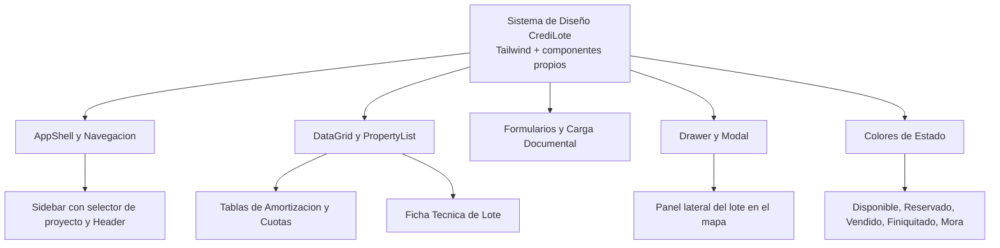

# 01.3 - Sistema de Diseño y UI

Este documento especifica el sistema de diseño visual de **CrediLote**: una biblioteca de componentes propia construida con **Tailwind CSS**, que toma como referencia los patrones de interfaz de [Saas UI](https://saas-ui.dev/) (AppShell, DataGrid, PropertyList, etc.) **sin depender de Saas UI ni de Chakra UI**.

> [!NOTE] Decisión D1
> Se descartó adoptar Saas UI / Chakra UI como dependencia. Los componentes propios evitan colisiones de especificidad entre Chakra y Tailwind, reducen el tamaño del bundle y ya estaban implementados. Ver [[04.2 - Plan de Corrección de Documentación]].



---

## 1. Principios

1. **Patrones de software de gestión:** layouts de panel administrativo inspirados en Saas UI (barra lateral, tarjetas de métricas, listas de propiedades).
2. **Alta densidad de información:** tipografía `Inter` en tamaños `text-xs`/`text-sm`, tablas compactas y tarjetas con borde fino.
3. **Accesibilidad básica:** foco visible (`focus:ring-2`) en botones, cierre de Drawer y Modal con `Escape`. Pendiente: auditoría ARIA y contraste.
4. **Composición segura de clases:** todos los componentes aceptan `className` y lo combinan con `twMerge`.

---

## 2. Catálogo de Componentes

Todos se encuentran en `src/shared/components/ui/` salvo que se indique lo contrario.

| Componente | Archivo | Uso en CrediLote | Estado |
| :--- | :--- | :--- | :--- |
| **`AppShell`** | `src/app/AppShell.tsx` | Marco general: barra lateral, cabecera y contenido. | ✅ |
| **`Sidebar`** | `src/app/Sidebar.tsx` | Barra clara estilo Saas UI (2026-09-27): marca, selector de proyecto con menú desplegable (iniciales, ubicación, marca del activo, "Nuevo proyecto"), módulos con indicador lateral del activo, usuario con estado y modo **contraído** (solo íconos, recordado en el navegador). | ✅ |
| **`Header`** | `src/app/Header.tsx` | Cabecera con el proyecto activo. | ✅ |
| **`DataGrid`** | `DataGrid.tsx` | Tablas de amortización, cuotas e inventario. Columnas configurables, `onRowClick`, estado vacío y de carga. Sin ordenamiento ni selección múltiple. | ✅ |
| **`PropertyList` / `Property`** | `PropertyList.tsx` | Ficha técnica del lote y resumen del contrato. | ✅ |
| **`Drawer`** | `Drawer.tsx` | Panel lateral al seleccionar un lote en el mapa. | ✅ |
| **`Modal`** | `Modal.tsx` | Diálogos (p. ej. nuevo proyecto, registro de pago). | ✅ |
| **`MetricCard`** | `MetricCard.tsx` | KPIs del Dashboard con icono, texto de ayuda y tendencia. | ✅ |
| **`Card`** | `Card.tsx` | Contenedor base (`elevated`, `outline`, `flat`). | ✅ |
| **`Button`** | `Button.tsx` | Variantes `primary`, `secondary`, `outline`, `ghost`, `danger`; soporta iconos y `isLoading`. | ✅ |
| **`Badge`** | `Badge.tsx` | Etiquetas de estado de lotes y cuotas. | ✅ |
| **Dropzone de archivos** | — | Carga de PDF / imagen por arrastrar y soltar. | 🔜 |
| **Formulario por pasos** | — | Flujo guiado de validación de promesas. Hoy es un formulario único. | 🔜 |
| **Barra de comandos (Ctrl+K)** | — | Búsqueda global de lote o comprador. | 🔜 |

---

## 3. Colores de Estado

Los colores deben ser coherentes entre mapa, etiquetas (`Badge`) y tarjetas.

| Estado | Relleno en mapa (hex) | Variante de `Badge` | Clases del `Badge` |
| :--- | :--- | :--- | :--- |
| **Disponible** | `#10B981` (emerald-500) | `available` | `bg-emerald-50 text-emerald-700 border-emerald-200` |
| **Reservado** | `#F59E0B` (amber-500) | `reserved` | `bg-amber-50 text-amber-700 border-amber-200` |
| **Vendido** | `#EF4444` (red-500) | `sold` | `bg-rose-50 text-rose-700 border-rose-200` |
| **Finiquitado** | `#3B82F6` (blue-500) | `info` | `bg-blue-50 text-blue-700 border-blue-200` |
| **En mora** (cuotas) | — | `overdue` | `bg-red-50 text-red-700 border-red-200` |
| **Neutral** | — | `neutral` | `bg-slate-100 text-slate-700 border-slate-200` |

> [!WARNING] Deuda técnica de tokens
> - `tailwind.config.js` define paletas `brand`, `sidebar` y `status` que **ningún componente usa**; los colores están escritos directamente en cada componente.
> - "Vendido" usa rojo en el mapa y *rose* en el `Badge`.
> - **Bug:** `InventoryView.tsx` asigna la variante `available` (verde) a los lotes `FINIQUITADO`; debería usar `info` (azul). Ya corregido en `CartographyView.tsx` (2026-09-27).
> - Los colores del mapa ahora están centralizados en `COLORES_ESTADO_LOTE` (`src/shared/components/map/marcadorLote.ts`).
>
> Acción propuesta: centralizar en un único módulo (p. ej. `src/shared/theme/status.ts`) que alimente tanto el mapa como `Badge`, y eliminar o usar los tokens de `tailwind.config.js`.

### Tipografía y base
- Fuente: `Inter`, con respaldo de fuentes del sistema; monoespaciada para folios y códigos.
- Fondo general: `bg-slate-100`; tarjetas blancas con `border-slate-200` y `rounded-xl`.
- Acento primario: `emerald-600` (botón `primary`).
- Modo oscuro: no implementado.

---

## 4. Patrón de Pantalla Dividida (Split-Screen)

Usado en el módulo de ingesta de promesas de venta:

```
+------------------------------------+------------------------------------+
|          PANEL DOCUMENTAL          |          PANEL DE DATOS            |
|                                    |                                    |
| - Visor del documento              | - Comprador y Vendedor             |
| - Controles de zoom y navegación   | - Lote, bloque y área              |
|                                    | - Condiciones financieras          |
|                                    | - Indicadores de confianza         |
|                                    |                                    |
|                                    | [ Cancelar ] [ Confirmar Registro ]|
+------------------------------------+------------------------------------+
```

---

## 5. Impresión

`src/index.css` oculta `aside`, `header`, `nav` y `button` bajo `@media print`, de modo que tablas de amortización y recibos se imprimen (o se guardan como PDF) desde el navegador.

---

Enlaces relacionados:
- Arquitectura: [[01.2 - Arquitectura y Stack Tecnológico]]
- Módulo de Ingesta: [[02.1 - Ingesta y Procesamiento de Promesas de Venta]]
- Módulo Cartográfico: [[02.2 - Módulo Geoespacial y Cartografía]]
