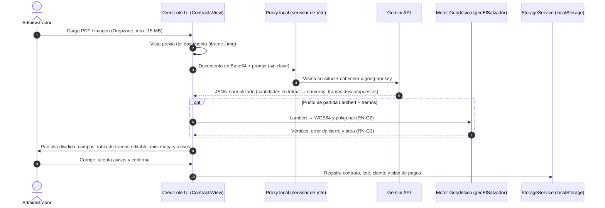

# 02.1 - Ingesta y Procesamiento de Promesas de Venta

Este módulo es el punto de entrada de información a CrediLote: transforma contratos y escrituras notariales (PDF o imágenes) en registros validados por el administrador.

> [!NOTE] Ejemplos ficticios
> Todos los nombres, DUI, montos y coordenadas de esta nota son **ficticios**. No se deben copiar datos de contratos reales al vault ni al código.

---

## 1. Formatos de Entrada Admitidos
- **PDF** (con capa de texto o escaneado) e **imágenes** JPG, PNG y WebP.
- Tamaño máximo: **15 MB**. Otros formatos se rechazan con un mensaje.
- **Muestra demostrativa:** botón "Muestra" con un contrato ficticio (lote de 340 m² en San Salvador).

---

## 2. Motor de Extracción con IA

Implementado en `src/modules/contracts/services/contractExtractor.ts` ([[ADR-010 - Extracción documental con Google Gemini API y conversión geodésica|ADR-010]]):
- **Proveedor:** Google Gemini, llamado a través del **proxy local** del servidor de Vite (`/api/gemini`). La clave vive en `.env.local` como `GEMINI_API_KEY` (sin prefijo `VITE_`) y el servidor la agrega en la cabecera `x-goog-api-key`: **no llega al navegador ni al build**. Ver [[01.4 - Seguridad y Protección de Datos]].
- **Cascada de modelos (2026-10-01):** `gemini-3.5-flash` → `gemini-3.6-flash` → `gemini-3.8-flash` → `gemini-flash-latest` → `gemini-3-flash-preview`. Cada modelo saturado (503), sin cuota (429) o con error interno (500) se **reintenta una vez** tras una espera (la que sugiera Google, máximo 20 s); si sigue fallando, pasa al siguiente. Un intento que tarda más de 150 s se abandona. Un modelo inexistente (404) se salta; una clave inválida o una solicitud rechazada (400, 401, 403) detiene el proceso. Si todos fallan, el mensaje explica que Google está saturado y qué respondió cada modelo. Pruebas: `contractExtractor.test.ts`.

> [!INFO] Error "Modelo … no disponible (503)" (2026-10-01)
> El 503 significa que los servidores de Google estaban saturados (*high demand*); no es un error de CrediLote ni de la clave. Antes, la cascada probaba 3 modelos una sola vez cada uno y mostraba solo el último error. En una prueba con un PDF ficticio, `3.5-flash` y `3.8-flash` respondieron 503; `3.6-flash` respondió completo en 7.8 s; `3-flash-preview` respondió en 12.7 s pero dejó en blanco la prima, el plazo y el día de pago, por eso va al final.
- **Normalización notarial salvadoreña:**
  - Cantidades y documentos escritos en letras → números (ej. *"cero cuatro cinco uno dos tres siete ocho - ocho"* → DUI `04512378-8`; *"VEINTE MIL DÓLARES"* → `20000`).
  - Crédito directo sin intereses cuando no se pacta tasa (`DIRECTO_SIN_INTERES`).
  - Segregaciones rústicas sin nomenclatura de lotificación se nombran como "Porción N m²".
- **Descripción técnica:** el modelo devuelve el punto de partida Lambert y los tramos **descompuestos** (`inicio`, `grados`, `minutos`, `segundos`, `fin`, `distancia`), para no depender de interpretar texto libre. Los tramos que no se pueden interpretar se omiten con un aviso.
- **Tipo de documento (2026-10-01):** el modelo indica si el archivo es una promesa, una compraventa, una remedición, una segregación u otro. Si no es una promesa ni una compraventa, se avisa que puede ser el archivo equivocado. También se avisa si falta el precio o la prima, o si hay tramos pero falta el punto de partida Lambert (sin él no se puede dibujar el lote). Los montos con formato (`"$20,400.00"`) se convierten a número y la confianza en fracción (0.95) se pasa a porcentaje.
- **Primer punto = punto de partida (2026-10-03):** el modelo toma como punto de partida el primer punto con coordenadas aunque el documento no lo llame así (RN-G2), y devuelve además el cuadro de coordenadas de los vértices si existe (`verticesLambert`). Verificado con Gemini con dos promesas ficticias: coordenada del "mojón uno" dentro del texto y cuadro "Punto 1: Y = …, X = …" al final; ambas se dibujan y cierran exacto.
- **Promesas sin descripción técnica (2026-10-03):** las promesas de lotes de una lotificación suelen traer solo número de lote, polígono, área y matrícula (sin rumbos, distancias ni coordenadas). Ahí no hay con qué dibujar: la extracción lo avisa y la confianza de coordenadas es 0 % (antes mostraba el 100 % que decía el modelo aunque no hubiera coordenadas). Para dibujarlos, el lote debe estar en el catálogo del proyecto con su polígono (del plano de la lotificación): al registrar la promesa con ese código, el lote **conserva su polígono y sus linderos** aunque el código venga con otras mayúsculas o tildes (antes la pantalla buscaba el código exacto y el registro podía borrar el polígono del catálogo).
  - Una promesa puede incluir **varios lotes** (caso real: lotes 16 y 17 de un mismo polígono). Hoy se registran como un solo lote con el área sumada: pendiente decidir si se separan.
- **Verificación de tramos con varias lecturas (2026-10-03, `verificacionTramos.ts`):** con un escaneo de páginas desordenadas, cada lectura de Gemini confundía 2 o 3 tramos y no siempre los mismos (ej. "once punto cero dos" leído como 1.02, que abrió el polígono 10 m; o minutos 35 → 30, que el cierre casi no nota). Ahora:
  1. La descripción técnica se lee **dos veces al mismo tiempo** (la lectura principal y una de solo los tramos), sin espera adicional.
  2. Si las lecturas no coinciden, no cuadran (cierre 1/1000 y área ±2 %) o falta algún tramo declarado, se hace **una tercera lectura** (un intento en los dos primeros modelos, para no alargar la espera).
  3. En cada tramo en duda se elige primero la versión con la que el polígono cuadra, después la que más se repite entre lecturas y, en empate, la que mejor cierra.
  4. Se avisa qué tramos estaban en duda para compararlos con el documento; si las lecturas coinciden pero no cuadran, se avisa que puede faltar una página o haber un error en el documento.
  - Prueba real con la promesa de 39 tramos: dos corridas terminaron con los 39 tramos idénticos al documento (una con dos lecturas coincidentes y otra que desempató los tramos 28 y 29 con la tercera).
- **Grados, minutos y segundos (2026-10-03):** si el documento da latitud y longitud en grados, minutos y segundos (13°18'12.9" N, 87°59'20.3" O), se convierten a grados decimales (grados + minutos/60 + segundos/3600, negativo al Sur y al Oeste), como un convertidor GPS. Si la longitud viene sin el signo del Oeste o latitud y longitud intercambiadas, se corrigen con aviso. Los **rumbos** de los tramos (ej. "Norte 80°11'33" Este") también se escriben en grados, minutos y segundos, pero son una **dirección**, no una posición: no se pueden convertir a latitud y longitud.
- **Linderos (2026-10-03):** de cada lindero se guarda en el lote cuántos tramos tiene y con qué colinda (`Lote.linderos`, ej. "10 tramos · Resto del Inmueble, calle de por medio").
- **Tramos completos (2026-10-03):** el modelo devuelve también cuántos tramos **dice el documento** que tiene cada lindero (`linderos[].tramosDeclarados`, ej. "formado por diez tramos" → 10). Si la suma no coincide con los tramos leídos, se avisa: menos tramos suele significar que **falta una página del PDF** (o que el modelo omitió tramos); más, que hay tramos repetidos. El total queda en `tramosDeclarados`.
- **Promesas sin coordenadas:** si hay tramos pero no punto de partida, se guarda cómo nombra la escritura ese punto (`referenciaPartida`, ej. "vértice Nor Poniente"), se revisan cierre y área, y los tramos se guardan con el lote para ubicarlo después en Cartografía ([[02.2 - Módulo Geoespacial y Cartografía]] §4).
- **Sin datos inventados:** si falta el plazo o el día de pago se propone un valor y se avisa; si solo viene el mojón 1, el lote queda **sin polígono** (no se dibuja una figura ficticia).

---

## 3. Integración Geodésica de El Salvador

Implementado en `src/shared/utils/geoElSalvador.ts` (reglas RN-G1 a RN-G3 de [[03.2 - Reglas de Negocio y Cálculos]]):
1. **Coordenadas Lambert oficiales** (Norte/Este en metros) → WGS84 con `lambertElSalvadorToWGS84()`. Verificado contra la definición oficial con diferencias menores a 3 cm. Supone datum SIRGAS-ES2007.
2. **Rumbos y distancias:** `calcularPoligonal()` reconstruye el polígono desde el mojón 1 y devuelve vértices, perímetro, **error de cierre** y **área**. `parseRumbo()` admite Norte/Sur, Este/Oriente, Oeste/Poniente/O y rechaza rumbos ilegibles en lugar de suponer Norte.
3. **Verificación:** `evaluarGeometria()` compara el cierre (≤ 1/1000) y el área con la escritura (≤ 2 % correcto, 2–5 % advertencia, > 5 % error).

> [!SUCCESS] Prueba con una escritura real (2026-09-27)
> Segregación rústica de 22 tramos (8 con rumbo "Oeste"). Antes de la corrección, el polígono quedaba abierto a **97.8 m** del mojón 1 porque "Oeste" se leía como "Este". Ahora cierra a **0.014 m** (1/11 370) y el área calculada es **1,319.88 m²** frente a 1,319.67 m² de la escritura (0.016 %). El caso quedó como prueba automática con el origen desplazado y sin datos personales (`geoElSalvador.test.ts`).

---

## 4. Interfaz de Validación en Pantalla Dividida

Implementado en `src/modules/contracts/ContractsView.tsx` y `components/DescripcionTecnica.tsx`:
- **Panel izquierdo:** vista previa del PDF (`<iframe>`) o de la imagen con zoom (70 % a 150 %).
- **Panel derecho:**
  - Avisos de la extracción.
  - Campos editables con insignias de confianza por grupo (**Partes**, **Financiero**, **GPS**): ≥ 85 % verde, 60–84 % ámbar, < 60 % rojo (RN-I2).
  - **Descripción técnica editable:** Norte/Este del mojón 1 (con su conversión a lat/lng) y tabla de tramos con agregar/eliminar.
  - Avisos de cierre y área, y **mini mapa satelital** con el polígono calculado.
  - Si hay advertencias de geometría, el administrador debe marcar que revisó el polígono antes de confirmar.
- **Validaciones (RN-I3):** DUI con dígito verificador (bloquea la confirmación si no es válido) y teléfono +503 (advertencia).
- **Registro:** crea cliente, contrato, lote y tabla de amortización. Antes valida los datos (RN-I3): por ejemplo, **no registra una venta de $0**. Si algo falla, no guarda nada y muestra el motivo arriba de la pantalla. La fecha de firma es la fecha local de hoy (antes se usaba la de UTC, que después de las 6 p. m. daba el día siguiente). Hoy el lote queda en `VENDIDO` porque el modelo v1 considera la prima pagada al firmar; la etapa `RESERVADO` de D6 llega con el Modelo v2 (cuotas de prima).

---

## 5. Pendientes

| Pendiente | Tarea del plan |
| :--- | :--- |
| Guardar el documento cargado (hoy se pierde al recargar la página). | 7.14 (depende de Dexie, 6.2) |
| Condiciones de privacidad para enviar contratos reales a Gemini (plan sin entrenamiento, consentimiento, bitácora). | 7.11 |
| Registrar la promesa como `RESERVADO` hasta completar la prima (D6). | 7.15 / 6.6 (Modelo v2) |
| Medir la mediana de tiempo por contrato (objetivo ≤ 60 s). | Criterio de [[01.1 - Visión y Objetivos]] |

---

Enlaces relacionados:
- [[02.2 - Módulo Geoespacial y Cartografía]]
- [[03.2 - Reglas de Negocio y Cálculos]] (RN-I1 a RN-I3, RN-G1 a RN-G3)
- [[04.1 - Fases de Implementación]]
- [[ADR-010 - Extracción documental con Google Gemini API y conversión geodésica]]
