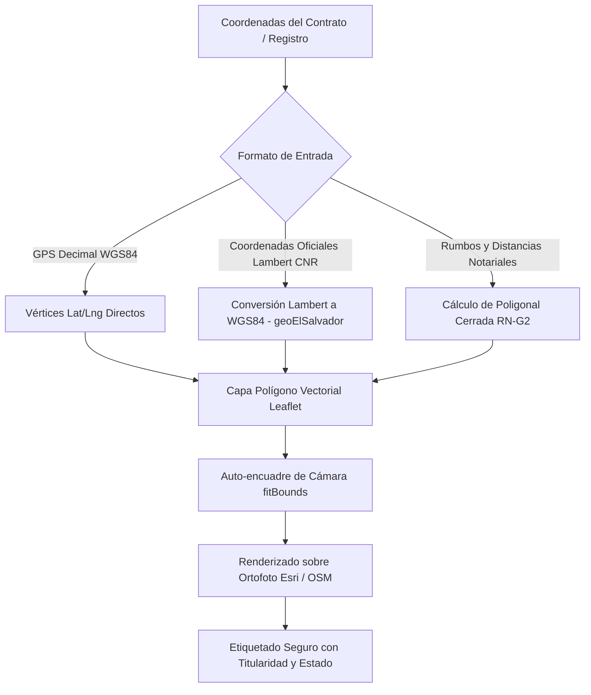

# 02.2 - Módulo Geoespacial y Cartografía de Terrenos

Este componente procesa las coordenadas geográficas de los contratos y levantamientos catastrales para generar polígonos vectoriales interactivos sobre mapas satelitales y cartografía base.

---

## 1. Renderizado de Terrenos y Geometrías

Cada parcela se modela como un polígono geodésico cerrado compuesto por una secuencia de vértices ordenados:
$$P = [(lat_1, lng_1), (lat_2, lng_2), (lat_3, lng_3), \dots, (lat_1, lng_1)]$$

### Características Cartográficas Implementadas:
1. **Doble Capa Cartográfica:**
   - **Ortofoto Satelital (Esri World Imagery):** Permite verificar la topografía real, accesos de terracería, vegetación y estado del terreno.
   - **Mapa Urbano Vectorial (OpenStreetMap):** Permite ubicar carreteras de acceso, trazado de calles y centros de población colindantes.
2. **Auto-encuadre de Cámara (`fitBounds`):**
   - Al cargar o registrar una parcela, Leaflet calcula la envolvente geográfica (`latLngBounds`) y ajusta dinámicamente el zoom para enfocar el lote sin necesidad de desplazamiento manual.
3. **Conversión Geodésica Oficial de El Salvador (`src/shared/utils/geoElSalvador.ts`):**
   - Coordenadas métricas de mojones catastrales del CNR / Instituto Geográfico Nacional (Lambert Conformal Conic de El Salvador).
   - Conversión a latitud/longitud WGS84, verificada contra la definición oficial con diferencias menores a 3 cm.
   - Supone el datum **SIRGAS-ES2007**. Escrituras antiguas referidas a un datum anterior pueden quedar desplazadas: verificar con un punto conocido.
   - Código EPSG del sistema proyectado: **por verificar** (se suele citar EPSG:5460, "SIRGAS-ES2007 / El Salvador Lambert").
4. **Cálculo de Poligonales por Rumbos y Distancias (RN-G2, RN-G3):**
   - Interpretación de linderos notariales (ej. *Sur 45°10'20" Oeste con 12.50 m*): Norte/Sur, Este/Oriente, Oeste/Poniente.
   - Cálculo del **error de cierre** (se exige 1/1000) y del **área**, comparada con la de la escritura (≤ 2 % correcto, 2–5 % advertencia, > 5 % error).
   - Un rumbo ilegible genera un aviso; nunca se supone Norte.
5. **Seguridad y Prevención XSS:**
   - Sanitización obligatoria de cadenas HTML en los tooltips flotantes de Leaflet (`polygon.bindTooltip`) para evitar inyecciones al renderizar nombres de compradores.

---

## 2. Convención Visual de Estados y Titularidad

Los lotes se diferencian mediante estilos visuales estandarizados:

| Estado Operativo | Color de Relleno y Contorno | Información en Etiqueta (Badge / Tooltip) |
| :--- | :--- | :--- |
| **Vendido** | Rojo (`#EF4444`) | Identificador del lote + Nombre del comprador + Saldo insoluto |
| **Reservado** | Ámbar (`#F59E0B`) | Identificador del lote + Nombre del interesado + Plazo de reserva |
| **Disponible** | Verde (`#10B981`) | Identificador del lote + Superficie ($m^2$) + Precio de lista |
| **Finiquitado** | Azul (`#3B82F6`) | Identificador del lote + Nombre del titular + "Saldo liquidado" |

Los valores de estado corresponden al tipo `EstadoLote` (`DISPONIBLE`, `RESERVADO`, `VENDIDO`, `FINIQUITADO`) definido en [[03.1 - Esquema de Base de Datos y Entidades]].

> [!NOTE] Panel Lateral de Detalle del Lote (Drawer)
> Al pulsar sobre cualquier parcela en el mapa se despliega un panel lateral con:
> - Titular del contrato y datos de contacto directo.
> - Superficie en metros cuadrados ($m^2$) y varas cuadradas ($v^2$).
> - Desglose de cuotas canceladas y saldo insoluto restante.
> - Accesos directos al plan de amortización financiero.

---

> [!BUG] Corregido el 2026-09-27
> `parseRumboToAzimuth` reemplazaba la palabra `ESTE` antes que `OESTE`, así que todo rumbo "Oeste" se interpretaba como "Este". Con una escritura real de 22 tramos, el polígono quedaba abierto a 97.8 m del mojón 1. La nueva función `parseRumbo` usa límites de palabra y tiene pruebas automáticas (`geoElSalvador.test.ts`).

---

## 3. Identificación de Lotes en el Mapa (2026-09-27)

Antes, un lote pequeño o alejado del resto "se perdía": el nombre solo aparecía al pasar el cursor y el mapa se alejaba para encuadrar todos los lotes (incluidos los de otros departamentos o países) hasta que el polígono era un punto invisible.

- **Pin con el código del lote** en el centroide (`centroidePoligono`), visible a cualquier zoom, del color del estado. El nombre del titular aparece al pasar el cursor o en el lote resaltado (`src/shared/components/map/marcadorLote.ts`).
- **Selector "Ir a lote"** y botón **"Ver todos"** en la barra del mapa.
- **Lote resaltado** (seleccionado, elegido en "Ir a lote" o recién registrado): contorno doble (halo blanco + color del estado) y pin con pulso.
- **"Ver en Mapa"** tras registrar una promesa abre el mapa centrado en ese lote.
- **Acercamiento hasta el nivel 20:** más allá del nivel 18 se amplía la última imagen satelital disponible en lugar de mostrar cuadros grises, para que el lote llene la vista.
- El mapa ya no se vuelve a alejar al hacer clic en un lote (antes redibujaba y reencuadraba en cada render).

---

## 4. Lotes sin coordenadas: ubicar en el mapa (2026-10-01)

Muchas promesas describen el terreno **solo con rumbos y distancias** ("partiendo del vértice Nor Poniente…"), sin las coordenadas del punto de partida. Con eso se conoce la **forma** del lote, pero no **dónde** está, y la app no inventa la ubicación (RN-G2).

- **Se guarda la descripción técnica** con el lote (`Lote.descripcionTecnica`: tramos, punto Lambert si existe, cómo se nombra el punto de partida y el origen en el mapa). Antes los tramos se perdían al registrar.
- **Ubicar después** (`storage.ubicarLote`):
  - con la **coordenada Lambert** del punto de partida (por ejemplo, del plano aprobado por el CNR): ubicación oficial (`ubicadoPor: 'LAMBERT'`);
  - o **marcando el punto de partida en el mapa satelital**: ubicación aproximada (`ubicadoPor: 'MAPA'`).
- Desde ese punto se calcula el polígono con los tramos, y se informa el cierre y el área.
- **Centro del mapa del proyecto:** si queda a más de 20 km de todos sus lotes dibujados (por ejemplo, porque se quedó en el valor por defecto de San Salvador), se mueve al centro de esos lotes.
- **Corregir tramos** de un lote registrado: `storage.guardarDescripcionTecnica` redibuja desde el mismo punto.
- **Revisión del cierre sin ubicación:** en Ingesta, el cierre y el área se calculan aunque falte el punto de partida, para detectar tramos mal leídos.

> [!WARNING] Caso real (2026-10-01)
> En una promesa de 39 tramos sin coordenadas, el único modelo de Gemini disponible en ese momento (el último de la cascada) leyó mal 6 tramos, 2 de ellos con distancias muy distintas. El polígono quedaba abierto **16 m**. Con los tramos corregidos según el documento cierra a **0.005 m** (1/82 000) y el área coincide con la escritura (0.006 %). Por eso el cierre se revisa siempre.

> [!WARNING] Caso real (2026-10-03): PDF con una página faltante
> Un acta de remedición de 21 tramos (Norte 1, Oriente 8, Sur 6, Poniente 6) llegó escaneada **sin la página del lindero poniente**. Se leyeron 15 tramos, el polígono quedaba abierto **85 m** y el área daba 21 % menos. Ahora la extracción compara los tramos leídos con los que el documento declara por lindero y avisa que puede faltar una página (ver [[02.1 - Ingesta y Procesamiento de Promesas de Venta]]).

> [!SUCCESS] Verificación con una promesa que sí trae coordenadas (2026-10-03)
> Una promesa real con el punto de partida en Lambert (NORTE ≈ 243 000, ESTE ≈ 609 500) y 22 tramos: la extracción leyó 22 de 22, el punto cae en El Carmen (La Unión), el cierre es de 0.014 m (1/11 000) y el área difiere 0.02 % de la escritura. Con coordenadas, el lote se dibuja solo y Cartografía lo encuadra.

La interfaz (botón "Ubicar en el mapa", lista de lotes sin ubicar) está en las indicaciones de [[04.4 - Indicaciones para Gemini (Frontend)]].

## 5. Próximas Mejoras Cartográficas (Pendientes)
- Modificación interactiva de vértices en el mapa mediante nodos arrastrables (*drag-and-drop*).
- Agrupar pines cuando muchos lotes se superponen a baja escala (*clustering*).

---

Enlaces relacionados:
- Reglas geoespaciales: [[03.2 - Reglas de Negocio y Cálculos]] (RN-G1 a RN-G3)
- Módulo de Ingesta: [[02.1 - Ingesta y Procesamiento de Promesas de Venta]]
- Módulo Financiero: [[02.3 - Motor Financiero y Amortización]]
- Gestión Territorial: [[02.4 - Inventario y Gestión de Proyectos]]
