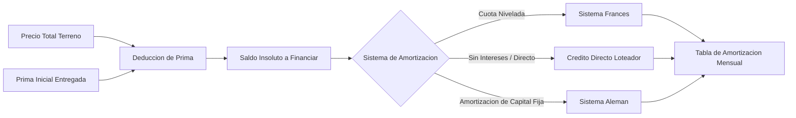

# 02.3 - Motor Financiero y Amortización

El motor financiero calcula el plan de pagos correspondiente a cada lote en función del precio total, la prima inicial entregada y las condiciones pactadas en el contrato.

---

## 1. Modelos Matemáticos de Amortización

### Parámetros de Entrada:
- $P_{\text{total}}$: Precio total pactado del lote.
- $Prima$: Anticipo abonado al momento de la firma.
- $S_0 = P_{\text{total}} - Prima$: Capital inicial a financiar.
- $n$: Número total de periodos mensuales convenidos.
- $r$: Tasa de interés anual pactada (en porcentaje).
- $i = \frac{r}{12 \times 100}$: Tasa de interés **nominal mensual proporcional** (no es la tasa efectiva; ver RN-F1).

> [!NOTE] Reglas detalladas
> Redondeo, tasa cero, fechas de vencimiento, abonos extraordinarios y ejemplos numéricos de los tres sistemas están en [[03.2 - Reglas de Negocio y Cálculos]] (RN-F1 a RN-F6).

---

### A. Sistema Francés (Cuota Nivelada)
Es el modelo predominante cuando se aplica tasa de interés sobre saldos insolutos. La cuota periódica ($C$) permanece constante:

$$C = S_0 \times \frac{i \times (1 + i)^n}{(1 + i)^n - 1}$$

Si $i = 0$, la fórmula no se puede evaluar y se usa $C = S_0 / n$ (RN-F2).

Desglose periódico para cada mes $t$ de $1$ a $n$:
1. **Interés devengado:** $I_t = S_{t-1} \times i$
2. **Amortización a capital:** $A_t = C - I_t$
3. **Saldo insoluto final:** $S_t = S_{t-1} - A_t$

---

### B. Sistema de Crédito Directo Loteador (Sin Tasa de Interés)
Frecuente en proyectos de parcelación donde el precio se distribuye de forma equitativa en cuotas mensuales directas:

$$C = \frac{S_0}{n}$$

Para cada periodo:
- Amortización a Capital = $C$
- Interés Ordinario = $0$
- Saldo Insoluto = $S_{t-1} - C$

---

### C. Sistema Alemán (Amortización Constante a Capital)
La porción aplicada a capital se mantiene uniforme en todos los periodos, resultando en cuotas decrecientes:
$$A_t = \frac{S_0}{n} \quad \text{(Uniforme)}$$
$$I_t = S_{t-1} \times i$$
$$C_t = A_t + I_t \quad \text{(Decreciente)}$$

---

## 2. Estructura de la Tabla de Amortización

Cada registro de la tabla generada contiene los siguientes campos:

| Campo | Definición | Valor Representativo |
| :--- | :--- | :--- |
| **Nº Cuota** | Índice correlativo del periodo (1 a $n$). | `Cuota 01 / 36` |
| **Fecha de Vencimiento** | Día límite estipulado para la cancelación del periodo. | `15/10/2026` |
| **Monto Cuota** | Importe exigible para el periodo. | `$ 250.00` |
| **Abono a Capital** | Fracción destinada a la reducción del pasivo. | `$ 210.00` |
| **Interés Ordinario** | Importe correspondiente al rendimiento financiero. | `$ 40.00` |
| **Saldo Insoluto** | Capital remanente adeudado tras el abono. | `$ 8,790.00` |
| **Estado del Periodo** | Condición del pago: `Pendiente`, `Pagado`, `En Mora`. | `Pagado (14/10)` |
| **Referencia de Recibo** | Folio asignado al comprobante de liquidación. | `PIN-2026-0089` |

---

## 3. Tratamiento de Eventos Financieros

1. **Abonos Extraordinarios a Capital:**
   - En caso de pagos anticipados por encima de la cuota pactada, el sistema permite:
     - **Reducción de Plazo:** Se mantiene el valor de la cuota y se disminuye el número de meses restantes.
     - **Reducción de Cuota:** Se mantiene el plazo residual y se recalcula una cuota mensual menor.
2. **Gestión de Moras y Penalizaciones:**
   - Parámetro configurable de días de gracia antes de la activación de mora.
   - Cálculo de recargos porcentuales o cargos fijos por retraso en el corte.
3. **Herramienta de Simulación:**
   - Permite al administrador ajustar montos de prima y plazos para presentar escenarios alternativos al comprador.

---

Enlaces relacionados:
- Reglas financieras: [[03.2 - Reglas de Negocio y Cálculos]] (RN-F1 a RN-F6)
- Módulo Cartográfico: [[02.2 - Módulo Geoespacial y Cartografía]]
- Módulo de Cobranza: [[02.5 - Clientes, Cobranza y Recibos]]
- Modelo de Datos: [[03.1 - Esquema de Base de Datos y Entidades]]
