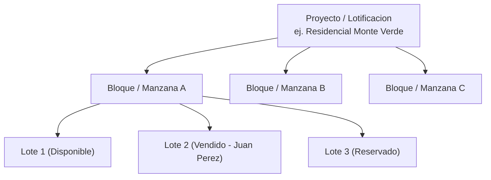
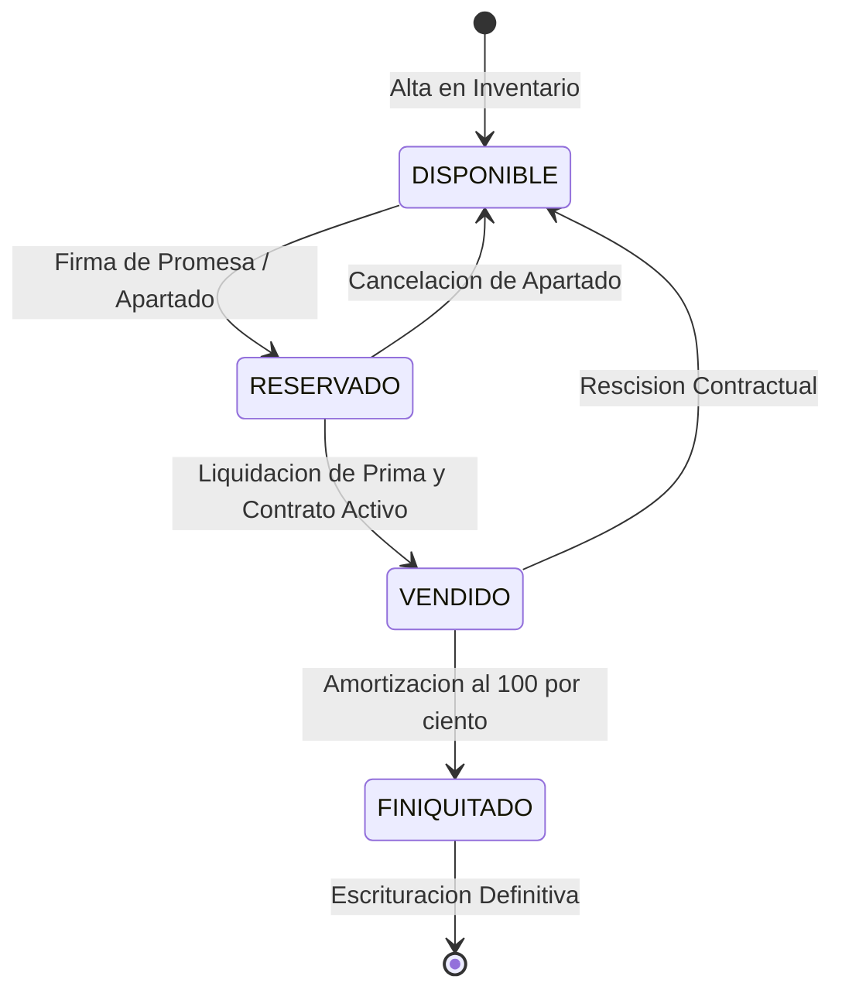

# 02.4 - Inventario y Gestión de Proyectos

Este módulo administra la estructura física y catastral de los desarrollos inmobiliarios, organizando los terrenos mediante jerarquías claras e independientes.

---

## 1. Estructura Jerárquica Territorial

1. **Proyecto / Desarrollo / Lotificación:**
   - Denominación comercial (ej. *"Hacienda Los Pinos - Etapa 1"*).
   - Localización administrativa (Departamento, Municipio y Distrito).
   - Coordenadas geográficas del polígono matriz de la finca.
   - Moneda contable principal (USD por defecto).
   - Prefijo de folios para los recibos (ej. *"PIN"*).
2. **Manzana / Bloque:**
   - Subdivisión catastral y operativa de los lotes (ej. *"Bloque A"*, *"Sector Norte"*).
3. **Lote / Parcela:**
   - Código identificador único (ej. *"L-A14"*).
   - Área superficial en metros cuadrados ($m^2$); se muestra también en varas cuadradas ($v^2$, 1 v² ≈ 0.6987 m²).
   - Polígono vectorial de vértices georreferenciados (Latitud/Longitud).
   - Condiciones topográficas (Plano, Semiplano, Pendiente).
   - Servicios disponibles (Red de agua, energía eléctrica, acceso afirmado, título legal).

---

## 2. Ciclo de Vida Operativo del Lote

| Estado (`EstadoLote`) | Color | Descripción |
| :--- | :--- | :--- |
| **`DISPONIBLE`** | Verde | Lote habilitado para comercialización y disponible para cotización en mapa. |
| **`RESERVADO`** | Ámbar | Inmueble con promesa de compraventa formalizada pendiente de liquidación total de prima. |
| **`VENDIDO`** | Rojo | Contrato en vigor (en pago) con tabla de amortización activa y cuotas periódicas vigentes. |
| **`FINIQUITADO`** | Azul | Inmueble con saldo insoluto en cero, transferible formalmente al comprador (escrituración). |

> [!NOTE] Decisión D6 (2026-09-26)
> Registrar la promesa deja el lote en `RESERVADO`; pasa a `VENDIDO` cuando todas las cuotas de prima están pagadas (la prima admite abonos). El estado del lote se deriva del estado de su contrato activo; ver invariante 5 en [[03.1 - Esquema de Base de Datos y Entidades]].
>
> ⚠️ El código actual (`storage.registrarPromesaVenta`) todavía marca `VENDIDO` al registrar la promesa, y ningún proceso asigna `FINIQUITADO`. La expiración de reservas, el finiquito y la rescisión están especificados en RN-L1 a RN-L5 de [[03.2 - Reglas de Negocio y Cálculos]].

---

Enlaces relacionados:
- Ciclo de vida del contrato y del lote: [[03.2 - Reglas de Negocio y Cálculos]] (RN-L1 a RN-L5)
- Módulo Cartográfico: [[02.2 - Módulo Geoespacial y Cartografía]]
- Módulo de Cobranza: [[02.5 - Clientes, Cobranza y Recibos]]
- Esquema de Datos: [[03.1 - Esquema de Base de Datos y Entidades]]
