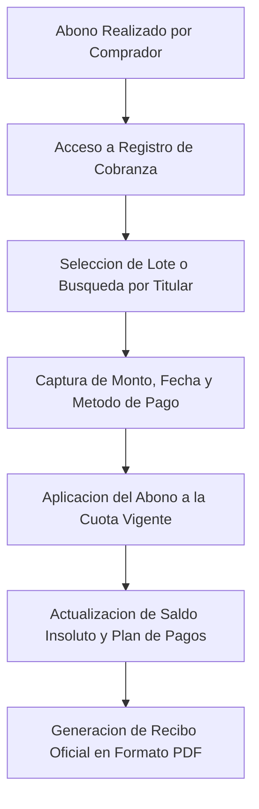

# 02.5 - Clientes, Cobranza y Recibos

Este módulo gestiona la cartera de compradores una vez formalizada la promesa de venta, procesando los ingresos periódicos y emitiendo los comprobantes de pago correspondientes.

---

## 1. Ficha del Comprador (Control de Titularidad)

El sistema centraliza el historial financiero de cada cliente:
- **Identificación Oficial:** Nombre completo, DUI y, si aplica, NIT.
- **Datos de Contacto:** Teléfono principal, canal de mensajería (WhatsApp) y correo electrónico.
- **Portafolio de Lotes:** Registro de todos los inmuebles asociados al mismo titular.
- **Estado de Cuenta Consolidado:**
  - **Al Día:** Sin cuotas vencidas pendientes a la fecha de corte.
  - **Próximo a Vencer:** Cuota exigible dentro de los siguientes 7 días naturales.
  - **En Mora:** Uno o más periodos impagados superando el periodo de gracia.

---

## 2. Registro y Aplicación de Pagos

El administrador registra las operaciones de ingreso mediante los siguientes parámetros:
1. **Fecha de Operación:** Registro cronológico de la recepción del dinero.
2. **Método de Liquidación:** Efectivo, Transferencia Bancaria, Depósito en Ventanilla o Cheque.
3. **Identificador de Transacción:** Número de referencia o folio bancario de la transferencia.
4. **Monto Recibido:**
   - **Pago Exacto:** Liquida en su totalidad la cuota del periodo vigente.
   - **Pago Parcial:** Aplica abono parcial y mantiene saldo pendiente en el periodo correspondiente.
   - **Pago Excedente:** Liquida la cuota del periodo y aplica el excedente a capital o a la cuota subsiguiente según selección administrativa.

---

## 3. Generación y Emisión de Recibos en PDF

El sistema genera comprobantes de pago formales listos para impresión en formato estándar o envío directo por canales digitales:

### Campos del Recibo Oficial:
- **Identificación Emisora:** Razón social del desarrollador o lotificadora, domicilio fiscal y contacto.
- **Folio Consecutivo:** Identificador irrepetible por proyecto y año con formato `PREFIJO-AAAA-NNNN` (ej. `PIN-2026-0042`); los folios anulados no se reutilizan.
- **Titular:** Nombre y número de identificación del comprador.
- **Datos del Inmueble:** Denominación del proyecto, bloque, lote y superficie catastral.
- **Concepto:** Descripción del periodo liquidado (ej. *"Liquidación de Cuota 12 de 36 - Octubre 2026"*).
- **Desglose Contable:**
  - Monto total pagado.
  - Aplicación a capital amortizado.
  - Aplicación a interés ordinario.
  - Aplicación a recargos moratorios (en su caso).
  - **Nuevo saldo insoluto resultante.**
- **Validación:** Espacio para firma de recepción y sello administrativo.

---

## 4. Documentos con formato de recibo (2026-09-30)

El contenido de cada documento se genera en `src/shared/documentos/documentos.ts`; la presentación es un componente aparte ([[04.4 - Indicaciones para Gemini (Frontend)]]).

| Documento | Cuándo se emite | Contenido principal |
| :--- | :--- | :--- |
| **Recibo de prima** | Al registrar la promesa (y para ventas anteriores, al abrir la app). | "Recibí de {comprador, DUI} la cantidad de {monto en letras} en concepto de prima (anticipo) de la promesa de venta del lote…", forma de pago, precio, saldo financiado y plazo. |
| **Recibo de pago** | Al cobrar cuotas. | Cuotas cubiertas (pagada o abono parcial), interés y capital aplicados, saldo pendiente después del pago. |
| **Comprobante de entrega** | Al entregar dinero a un beneficiario o responsable de gastos. | Participación acumulada, reembolsos, entregado antes, entregado ahora y saldo pendiente. |
| **Estado de cuenta de beneficiarios** (2026-10-03) | Cuando se pide en Beneficiarios ("Estado de cuenta"). | Resumen (cobrado, repartido, entregado, pendiente), **una tabla de saldos por cada lote vendido** (comprador, cobrado y total del lote), repartos de cada cobro (anulados tachados) y entregas con su lote; firma de quien lo elabora. `construirEstadoCuentaBeneficiarios` / `storage.getEstadoCuentaBeneficiarios()`. |

- **Folio** por proyecto y año: `SLM-2026-0001` (recibos) y `SLM-ENT-2026-0001` (entregas).
- **Monto en letras** al estilo notarial: *"UN MIL CIENTO VEINTICINCO 00/100 DÓLARES DE LOS ESTADOS UNIDOS DE AMÉRICA"*.
- **Firmas:** quien recibe y quien entrega (en las sucesiones, el representante).
- **Anulados:** conservan su folio y muestran motivo y fecha.
- **Nota en el pie:** comprobante interno; no sustituye al DTE cuando sea exigible (pendiente de validación contable, 01.1).
- **Diseño e impresión (2026-10-03):** hoja carta con encabezado del emisor, título y folio, recuadro "Por US$ …", doble línea, texto del recibo en letra serif, detalle con líneas punteadas, firmas y pie con el folio; los anulados llevan marca de agua. Se imprimen **solos** con `imprimirElemento` (`src/shared/utils/imprimir.ts`): el documento se copia a un marco aparte con los estilos de la app y se imprime solo ese marco. Antes se imprimía la pantalla ocultando partes con CSS y en el PDF salían pedazos de la vista. El nombre sugerido del PDF es el del documento (p. ej. "Recibo SLM-2026-0001"). Los componentes no usan `<header>`, `<nav>` ni `<button>`, que la hoja de impresión de la app oculta. Verificado imprimiendo a PDF con Edge.

Enlaces relacionados:
- Aplicación de pagos, mora, folios y estado de cuenta: [[03.2 - Reglas de Negocio y Cálculos]] (RN-C1 a RN-C5)
- Motor Financiero: [[02.3 - Motor Financiero y Amortización]]
- Indicadores de Control: [[02.6 - Dashboard y Analítica Administrativa]]
- Esquema de Datos: [[03.1 - Esquema de Base de Datos y Entidades]]
