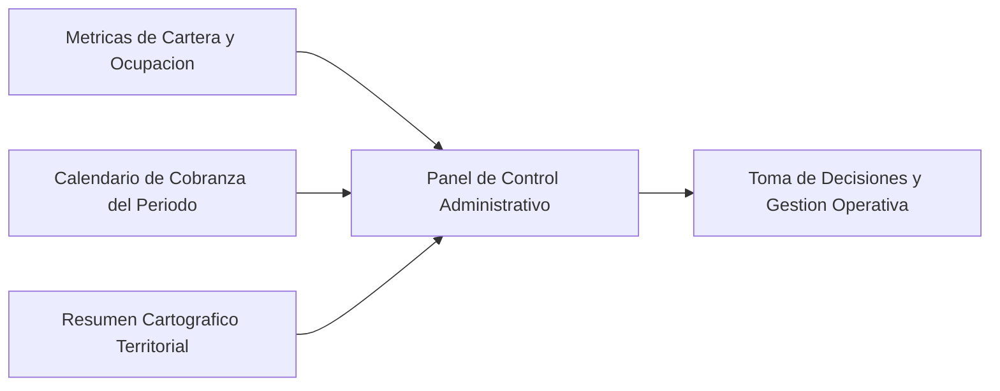

# 02.6 - Dashboard y Analítica Administrativa

El Tablero de Control Administrativo provee una panorámica unificada de las operaciones comerciales, los indicadores de cartera y el estado de cobranza periódica.

---

## 1. Indicadores Clave de Desempeño (KPIs)

1. **Estado del Inventario Territorial:**
   - Cantidad total de lotes registrados en el sistema.
   - Distribución porcentual: Disponibles frente a Reservados, Vendidos y Finiquitados.
   - **Tasa de colocación:** proporción del inventario ya comprometido con un comprador.
     $$\text{Tasa de colocación} = \frac{\text{Lotes Vendidos} + \text{Lotes Finiquitados}}{\text{Total de Lotes}} \times 100$$
     Los lotes reservados se muestran aparte y no cuentan como colocados.
2. **Volumen de Primas Recaudadas:**
   - Importe acumulado en concepto de anticipos o primas cobradas en el mes y en el ejercicio anual.
3. **Valor Total de la Cartera por Cobrar:**
   - Saldo global insoluto de todos los contratos vigentes de financiamiento.
4. **Eficiencia de Cobranza Mensual:**
   - Importe proyectado de cuotas correspondientes al mes corriente.
   - Importe efectivamente cobrado a la fecha.
   - Ratio de efectividad de recaudo ($\frac{\text{Cobrado}}{\text{Proyectado}} \times 100$).
5. **Índice de Morosidad:**
   - Número de contratos con cuotas en situación de mora (> 15 días o > 30 días de retraso).
   - Capital insoluto en riesgo de incobrabilidad.

---

## 2. Programación de Cobranza y Alertas Operativas

El panel prioriza las acciones de cobranza requeridas:
- **Vencimientos Inmediatos:** Listado de titulares con obligaciones de pago dentro de los próximos 7 días para gestión preventiva.
- **Vencimientos del Día:** Liquidaciones exigibles en la fecha de consulta.
- **Acceso Directo a Notificación:** Generación de mensaje estructurado con el estado de cuenta y datos bancarios para facilitar el depósito del cliente.

---

## 3. Visualización Cartográfica Ejecutiva

- Miniatura interactiva de los desarrollos con filtrado ágil por proyecto para supervisar el avance de ventas y lotes remanentes.

---

Enlaces relacionados:
- Agrupación de morosidad y estado de cuenta: [[03.2 - Reglas de Negocio y Cálculos]] (RN-C5)
- Módulo Cartográfico: [[02.2 - Módulo Geoespacial y Cartografía]]
- Módulo de Cobranza: [[02.5 - Clientes, Cobranza y Recibos]]
- Fases de Implementación: [[04.1 - Fases de Implementación]]
