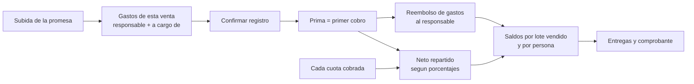

# 02.7 - Beneficiarios y Gastos de Venta

Módulos para proyectos cuyo terreno pertenece a una **sucesión**: los gastos de cada venta se reembolsan a quien los hizo y el resto de lo cobrado se reparte entre los **beneficiarios** según su porcentaje. Plan y decisiones: [[04.3 - Plan Sucesión, Beneficiarios y Gastos de Venta]] · [[ADR-011 - Reparto de cobros a beneficiarios y reembolso de gastos]].

---

## 1. Proyecto de tipo sucesión

- En **Editar proyecto** (lápiz junto a cada proyecto en el menú de la barra lateral) se elige el propietario: **Propio** o **Sucesión**, y el **representante** que firma.
- Desde el mismo formulario se puede **eliminar** un proyecto; si tiene lotes, hay que elegir a qué proyecto moverlos (con contratos, gastos y repartos).
- `src/app/ProyectoFormModal.tsx`, `storage.updateProyecto()` / `deleteProyecto()`.

## 2. Beneficiarios (módulo "Beneficiarios")

- Tabla editable: nombre, DUI (con dígito verificador), teléfono, cuenta bancaria opcional, **porcentaje** y activo.
- Los porcentajes de los activos deben sumar **100 %** para poder guardar. El botón **"Partes iguales"** asigna 100/n a cada activo con precisión completa (se muestra 14.2857 % para 7).
- Un beneficiario que ya recibió repartos no se puede eliminar: se desactiva. Los cambios de porcentaje solo afectan a los cobros futuros.

## 3. Gastos de venta

- **Al subir la promesa** (sección *4. Gastos de esta Venta* de [[02.1 - Ingesta y Procesamiento de Promesas de Venta]]): se agregan antes de confirmar y quedan amarrados al lote y al contrato.
- **Después**, en el módulo **"Gastos de Venta"**: se agregan a una venta existente, se filtran por venta y se eliminan mientras no se hayan reembolsado.
- Cada gasto tiene:
  - **Categoría:** gestión/comisión de venta, honorarios de abogado/notario, escrituración, levantamiento topográfico, inscripción CNR, solvencias e impuestos, otros.
  - **A cargo de:** `Sucesión` (se reembolsa y se descuenta del reparto) o `Comprador` (solo control).
  - **Responsable:** uno de los beneficiarios u **otra persona**; es quien recibe el reembolso.
- El panel del lote en el mapa muestra el resumen de gastos de esa venta.

## 4. Reparto de cobros

- **La prima es el primer cobro:** al confirmar la promesa se reembolsan los gastos de la sucesión y el resto se reparte. Si los gastos superan la prima, el saldo se cubre con las cuotas siguientes.
- **Cada cuota cobrada** en Cobranza se reparte automáticamente.
- Los centavos que sobran al dividir se asignan uno a uno **en rotación** entre los beneficiarios, para que nadie gane ni pierda a la larga.
- **Cobros sin repartir:** primas y cuotas registradas antes de configurar los beneficiarios aparecen en una lista con el botón **Repartir**. Antes de repartir una prima, conviene registrar los gastos de esa venta para que se reembolsen de ella.
- Motor puro con pruebas: `src/modules/beneficiarios/engine/reparto.ts` (reglas RN-B1 a RN-B5 de [[03.2 - Reglas de Negocio y Cálculos]]).

## 5. Saldos y entregas

- **Saldos por lote vendido** (2026-10-03): un bloque por venta (lote, comprador, cobrado, entregado y pendiente) con la tabla de sus personas: repartido + reembolsos − entregado = **pendiente**, para cada beneficiario y cada responsable externo de gastos de esa venta. Los bloques con saldo se abren solos y los ya entregados quedan plegados. Así una venta no se confunde con otra (RN-B5).
- **Registrar entrega:** desde la fila de la persona **en el lote**; monto (no puede superar lo pendiente de ese lote), fecha, método, referencia y notas; genera un **comprobante imprimible** que dice de qué lote sale el dinero.
- El **tablero** muestra el total pendiente de entregar y los cobros sin repartir.

## 6. Negociaciones previas a la venta (módulo "Negociaciones")

Decisión: [[ADR-012 - Negociaciones previas a la venta]].

| Estado | Qué significa | Acciones |
| :--- | :--- | :--- |
| **En negociación** | Conversación abierta con un interesado. | Agregar gastos (gasolina, viáticos…), editar datos, **Completada**, **Cancelar**. |
| **Esperando promesa** | Acuerdo cerrado; falta subir la promesa. El lote elegido queda **Reservado**. | **Subir promesa** (abre la ingesta ya vinculada), **Reabrir**, **Cancelar**. |
| **Convertida en venta** | La promesa se registró. Sus gastos pasaron a la venta y se reembolsan de la prima. | Ver en mapa. |
| **Cancelada** | No hubo venta. | Al cancelar se elige quién asume los gastos. |

- **Datos:** interesado y teléfono, lote existente (opcional) o descripción libre del terreno, precio y prima acordados, quién negocia (responsable por defecto de los gastos) y notas.
- **Subir la promesa:** la ingesta muestra *"Viene de la negociación"* (también se puede elegir a mano), precarga nombre, teléfono, lote, precio y prima, y resume cuánto de la prima se usará para reembolsar los gastos de la negociación.
- **Cancelación:** si la asume la **sucesión**, los gastos se reembolsan con la **próxima prima** que se cobre en el proyecto. Si la asume **quien los hizo**, quedan marcados "a cargo del responsable" y no se reembolsan.
- **Avisos:** contador en la barra lateral y avisos en el módulo, el tablero y la ingesta mientras haya negociaciones esperando promesa.
- En **Gastos de Venta**, los gastos de negociación muestran *"Negociación: nombre"* hasta que se convierten en venta.

## 7. Reglas añadidas el 2026-09-30

- **Beneficiarios:** nombre obligatorio, DUI válido y sin duplicados; no se elimina a quien tiene repartos, gastos, entregas o negociaciones (se desactiva).
- **Gastos:** monto mayor que cero, fecha y responsable del proyecto; se pueden **corregir** mientras no se hayan reembolsado.
- **Repartos:** "repartir todos" procesa en orden de fecha los cobros sin repartir.
- **Entregas:** no pueden superar lo pendiente de la persona en ese lote; "entregar a todos" se hace por lote y genera una entrega con folio por persona.
- **Anulación de cobros:** su reparto queda anulado; si ya se había entregado ese dinero, el saldo queda negativo (*a devolver*).

## 8. Limitaciones actuales

| Limitación | Motivo / tarea |
| :--- | :--- |
| Las devoluciones (saldos negativos) solo se informan; no hay registro de reintegros. | Pendiente de definir el procedimiento. |
| No se pueden crear lotes a mano: las negociaciones suelen usar la descripción libre del terreno. | Alta manual de lotes pendiente (Fase 2 del roadmap). |
| Los datos viven solo en este navegador. | Respaldo JSON y Dexie pendientes (tareas 6.7 y 6.2). |

---

Enlaces relacionados:
- [[02.5 - Clientes, Cobranza y Recibos]]
- [[03.1 - Esquema de Base de Datos y Entidades]]
- [[03.2 - Reglas de Negocio y Cálculos]]
