# 03.1 - Esquema de Base de Datos y Entidades (Modelo v2)

Este documento define el modelo de datos de **CrediLote**: entidades, relaciones, interfaces TypeScript y esquema de almacenamiento en IndexedDB (Dexie.js).

> [!IMPORTANT] Modelo v2 — especificado, aún no implementado
> Este modelo reemplaza al v1 que hoy existe en `src/shared/types/index.ts`. La migración del código está planificada en la Fase 6 de [[04.2 - Plan de Corrección de Documentación]]. La sección 7 lista las diferencias con el v1.
>
> **Regla de consistencia:** el diagrama ER (sección 2) y las interfaces TypeScript (sección 3) deben coincidir campo por campo. Cualquier cambio se hace en ambos lugares a la vez.

---

## 1. Decisiones que dan forma al modelo

| Decisión | Efecto en el modelo |
| :--- | :--- |
| **D2** Dexie / IndexedDB | Los documentos PDF se guardan como `Blob` en la tabla `documentos`. Se define un esquema de índices (sección 5). |
| **D4** El Salvador | Moneda `USD` por defecto. Personas: `dui`; personas jurídicas: `nit`. Ubicación: departamento, municipio y distrito. |
| **D5** Folios por proyecto y año | `Proyecto.prefijoFolio` + tabla `contadoresFolio` con el último número por proyecto y año. |
| **D6** Reservado → Vendido al liquidar la prima | La prima se modela como **cuotas de tipo `PRIMA`**. El contrato inicia en estado `RESERVA` y pasa a `VIGENTE` cuando todas sus cuotas de prima están pagadas. |
| **D7** Recargo → interés → capital | Cada pago se reparte en `AplicacionPago` con los importes aplicados a recargo, interés y capital por cuota. |

### Convenciones
- **Identificadores:** `string` con prefijo por entidad (`proj-`, `blq-`, `lote-`, `cli-`, `ven-`, `ctr-`, `cuo-`, `pag-`, `apl-`, `rec-`, `doc-`, `evt-`).
- **Fechas de negocio:** `string` en formato `YYYY-MM-DD`, sin hora ni zona horaria.
- **Marcas de tiempo:** `string` ISO 8601 completo (`createdAt`, `updatedAt`).
- **Montos:** `number` en la moneda del proyecto, redondeados a 2 decimales. La regla de redondeo se define en la Fase 3.
- **Superficie:** se almacena solo en m² (`areaM2`). Las varas cuadradas se calculan al mostrar (1 v² ≈ 0.6987 m²).

---

## 2. Diagrama Entidad-Relación

```mermaid
erDiagram
    PROYECTO ||--o{ BLOQUE : "se divide en"
    PROYECTO ||--o{ LOTE : contiene
    BLOQUE ||--o{ LOTE : agrupa
    PROYECTO ||--|| CONFIGURACION_COBRANZA : parametriza
    PROYECTO ||--o{ CONTADOR_FOLIO : numera
    LOTE ||--o{ CONTRATO_PROMESA : "objeto de"
    CLIENTE ||--o{ CONTRATO_PROMESA : firma
    VENDEDOR ||--o{ CONTRATO_PROMESA : otorga
    CONTRATO_PROMESA ||--o{ DOCUMENTO : adjunta
    CONTRATO_PROMESA ||--|{ CUOTA : programa
    CONTRATO_PROMESA ||--o{ PAGO : recibe
    CONTRATO_PROMESA ||--o{ EVENTO_CONTRATO : registra
    CLIENTE ||--o{ PAGO : realiza
    PAGO ||--|{ APLICACION_PAGO : "se distribuye en"
    CUOTA ||--o{ APLICACION_PAGO : "es cubierta por"
    PAGO ||--|| RECIBO_PAGO : respalda

    PROYECTO {
        string id PK
        string nombre
        string descripcion "opcional"
        string prefijoFolio "ej. PIN"
        string departamento
        string municipio
        string distrito "opcional"
        string direccion "opcional"
        json centroMapa "CoordenadaGPS"
        int zoomDefault
        json poligonoMatriz "CoordenadaGPS[] opcional"
        string moneda "USD por defecto"
        json emisor "DatosEmisor"
        string createdAt
        string updatedAt
    }

    BLOQUE {
        string id PK
        string proyectoId FK
        string nombre "ej. Bloque A"
        int orden
    }

    LOTE {
        string id PK
        string proyectoId FK
        string bloqueId FK
        string codigoLote "unico por proyecto"
        float areaM2
        float precioLista
        string estado "EstadoLote"
        json verticesPoligono "CoordenadaGPS[]"
        json linderos "opcional"
        string topografia "opcional"
        json servicios "ServicioLote[]"
        string notas "opcional"
        string createdAt
        string updatedAt
    }

    CLIENTE {
        string id PK
        string nombreCompleto
        string dui "00000000-0"
        string nit "opcional"
        string telefono "+503 0000-0000"
        string whatsapp "opcional"
        string email "opcional"
        string direccion "opcional"
        string createdAt
        string updatedAt
    }

    VENDEDOR {
        string id PK
        string tipoPersona "NATURAL | JURIDICA"
        string nombreRazonSocial
        string dui "si es persona natural"
        string nit "si es persona juridica"
        string domicilio
        string representanteLegal "opcional"
        string createdAt
    }

    CONTRATO_PROMESA {
        string id PK
        string proyectoId FK
        string loteId FK
        string clienteId FK
        string vendedorId FK
        string estado "EstadoContrato"
        date fechaFirma
        date fechaLimiteReserva
        float precioPactado
        float primaPactada
        int cuotasPrima
        float saldoFinanciado
        int plazoMeses
        float tasaInteresAnual
        string sistemaAmortizacion "SistemaAmortizacion"
        int diaCortePago
        date fechaPrimerVencimiento
        string createdAt
        string updatedAt
    }

    DOCUMENTO {
        string id PK
        string contratoId FK
        string nombreArchivo
        string mimeType
        int tamanoBytes
        blob contenido
        string createdAt
    }

    CUOTA {
        string id PK
        string contratoId FK
        string tipo "PRIMA | FINANCIAMIENTO"
        int numeroCuota
        date fechaVencimiento
        float montoCuota
        float abonoCapital
        float abonoInteres
        float saldoInsoluto
        float capitalPagado
        float interesPagado
        float recargoGenerado
        float recargoPagado
        string estado "EstadoCuota"
        date fechaPagoCompleto "opcional"
    }

    PAGO {
        string id PK
        string proyectoId FK
        string contratoId FK
        string clienteId FK
        date fechaPago
        float montoRecibido
        string metodoPago "MetodoPago"
        string referenciaBancaria "opcional"
        string destinoExcedente "DestinoExcedente opcional"
        string notas "opcional"
        boolean anulado
        string createdAt
    }

    APLICACION_PAGO {
        string id PK
        string pagoId FK
        string cuotaId FK
        float montoRecargo
        float montoInteres
        float montoCapital
    }

    RECIBO_PAGO {
        string id PK
        string pagoId FK
        string proyectoId FK
        string folio "PIN-2026-0001"
        int anio
        int secuencia
        date fechaEmision
        string concepto
        float montoTotal
        float totalRecargo
        float totalInteres
        float totalCapital
        float saldoAnterior
        float saldoResultante
        json snapshot "SnapshotRecibo"
        string estado "EMITIDO | ANULADO"
        string motivoAnulacion "opcional"
        date fechaAnulacion "opcional"
    }

    CONTADOR_FOLIO {
        string id PK "proyectoId-anio"
        string proyectoId FK
        int anio
        int ultimoNumero
    }

    CONFIGURACION_COBRANZA {
        string proyectoId PK
        int diasGracia
        string tipoRecargo "PORCENTAJE | MONTO_FIJO"
        float valorRecargo
        string periodicidadRecargo "UNICO | MENSUAL"
        json umbralesMoraDias "int[] ej. 15, 30"
        int diasAvisoVencimiento
        int diasReservaPorDefecto
        string updatedAt
    }

    EVENTO_CONTRATO {
        string id PK
        string contratoId FK
        string tipo "TipoEventoContrato"
        date fecha
        string descripcion
        json datos "opcional"
        string pagoId FK "opcional"
        string createdAt
    }
```



---

## 3. Tipos en TypeScript

```typescript
// ---------- Enumeraciones ----------
export type EstadoLote = 'DISPONIBLE' | 'RESERVADO' | 'VENDIDO' | 'FINIQUITADO';
export type EstadoContrato = 'RESERVA' | 'VIGENTE' | 'FINIQUITADO' | 'RESCINDIDO' | 'CANCELADO';
export type SistemaAmortizacion = 'FRANCES' | 'DIRECTO_SIN_INTERES' | 'ALEMAN';
export type TipoCuota = 'PRIMA' | 'FINANCIAMIENTO';
export type EstadoCuota = 'PENDIENTE' | 'ABONO_PARCIAL' | 'PAGADO' | 'ANULADO';
export type MetodoPago = 'EFECTIVO' | 'TRANSFERENCIA' | 'DEPOSITO' | 'CHEQUE';
export type DestinoExcedente = 'SIGUIENTE_CUOTA' | 'ABONO_CAPITAL';
export type TipoPersona = 'NATURAL' | 'JURIDICA';
export type Topografia = 'PLANO' | 'SEMIPLANO' | 'PENDIENTE';
export type ServicioLote = 'AGUA' | 'ENERGIA' | 'ACCESO_AFIRMADO' | 'DRENAJE' | 'TITULO_LEGAL';
export type EstadoRecibo = 'EMITIDO' | 'ANULADO';
export type TipoRecargo = 'PORCENTAJE' | 'MONTO_FIJO';
export type PeriodicidadRecargo = 'UNICO' | 'MENSUAL';
export type TipoEventoContrato =
  | 'RESERVA_CREADA'
  | 'PRORROGA_RESERVA'
  | 'CANCELACION_RESERVA'
  | 'PRIMA_COMPLETADA'
  | 'ABONO_EXTRAORDINARIO'
  | 'REESTRUCTURACION'
  | 'RESCISION'
  | 'FINIQUITO'
  | 'PAGO_ANULADO';

// ---------- Tipos auxiliares ----------
export interface CoordenadaGPS {
  lat: number;
  lng: number;
}

export interface Linderos {
  norte?: string;
  sur?: string;
  este?: string;
  oeste?: string;
}

/** Datos de la lotificadora que aparecen en los recibos. */
export interface DatosEmisor {
  razonSocial: string;
  nit: string;
  domicilio: string;
  telefono?: string;
  email?: string;
}

/** Copia congelada de los datos al momento de emitir el recibo. */
export interface SnapshotRecibo {
  emisor: DatosEmisor;
  clienteNombre: string;
  clienteDui: string;
  proyectoNombre: string;
  bloqueNombre: string;
  codigoLote: string;
  areaM2: number;
}

// ---------- Entidades ----------
export interface Proyecto {
  id: string;
  nombre: string;
  descripcion?: string;
  prefijoFolio: string; // ej. "PIN"
  departamento: string;
  municipio: string;
  distrito?: string;
  direccion?: string;
  centroMapa: CoordenadaGPS;
  zoomDefault: number;
  poligonoMatriz?: CoordenadaGPS[];
  moneda: string; // "USD" por defecto
  emisor: DatosEmisor;
  createdAt: string;
  updatedAt: string;
}

export interface Bloque {
  id: string;
  proyectoId: string;
  nombre: string; // ej. "Bloque A"
  orden: number;
}

export interface Lote {
  id: string;
  proyectoId: string;
  bloqueId: string;
  codigoLote: string; // ej. "L-A14", único por proyecto
  areaM2: number;
  precioLista: number;
  estado: EstadoLote;
  verticesPoligono: CoordenadaGPS[];
  linderos?: Linderos;
  topografia?: Topografia;
  servicios: ServicioLote[];
  notas?: string;
  createdAt: string;
  updatedAt: string;
}

export interface Cliente {
  id: string;
  nombreCompleto: string;
  dui: string; // "00000000-0"
  nit?: string;
  telefono: string; // "+503 0000-0000"
  whatsapp?: string;
  email?: string;
  direccion?: string;
  createdAt: string;
  updatedAt: string;
}

export interface Vendedor {
  id: string;
  tipoPersona: TipoPersona;
  nombreRazonSocial: string;
  dui?: string; // obligatorio si tipoPersona = NATURAL
  nit?: string; // obligatorio si tipoPersona = JURIDICA
  domicilio: string;
  representanteLegal?: string;
  createdAt: string;
}

export interface ContratoPromesa {
  id: string;
  proyectoId: string;
  loteId: string;
  clienteId: string;
  vendedorId: string;
  estado: EstadoContrato;
  fechaFirma: string;
  fechaLimiteReserva: string;
  precioPactado: number;
  primaPactada: number;
  cuotasPrima: number; // 1 = prima de contado
  saldoFinanciado: number; // precioPactado - primaPactada
  plazoMeses: number;
  tasaInteresAnual: number; // porcentaje, ej. 12 = 12 %
  sistemaAmortizacion: SistemaAmortizacion;
  diaCortePago: number; // 1–31
  fechaPrimerVencimiento: string;
  createdAt: string;
  updatedAt: string;
}

export interface Documento {
  id: string;
  contratoId: string;
  nombreArchivo: string;
  mimeType: string; // "application/pdf", "image/jpeg", ...
  tamanoBytes: number;
  contenido: Blob;
  createdAt: string;
}

export interface Cuota {
  id: string;
  contratoId: string;
  tipo: TipoCuota;
  numeroCuota: number; // correlativo dentro de su tipo
  fechaVencimiento: string;
  // Valores programados
  montoCuota: number;
  abonoCapital: number;
  abonoInteres: number;
  saldoInsoluto: number; // saldo programado tras esta cuota
  // Valores cobrados (acumulados de AplicacionPago)
  capitalPagado: number;
  interesPagado: number;
  recargoGenerado: number;
  recargoPagado: number;
  estado: EstadoCuota;
  fechaPagoCompleto?: string;
}

export interface Pago {
  id: string;
  proyectoId: string;
  contratoId: string;
  clienteId: string;
  fechaPago: string;
  montoRecibido: number;
  metodoPago: MetodoPago;
  referenciaBancaria?: string;
  destinoExcedente?: DestinoExcedente;
  notas?: string;
  anulado: boolean;
  createdAt: string;
}

export interface AplicacionPago {
  id: string;
  pagoId: string;
  cuotaId: string;
  montoRecargo: number;
  montoInteres: number;
  montoCapital: number;
}

export interface ReciboPago {
  id: string;
  pagoId: string;
  proyectoId: string;
  folio: string; // "PIN-2026-0001"
  anio: number;
  secuencia: number;
  fechaEmision: string;
  concepto: string; // ej. "Cuota 12 de 36 - Octubre 2026"
  montoTotal: number;
  totalRecargo: number;
  totalInteres: number;
  totalCapital: number;
  saldoAnterior: number;
  saldoResultante: number;
  snapshot: SnapshotRecibo;
  estado: EstadoRecibo;
  motivoAnulacion?: string;
  fechaAnulacion?: string;
}

export interface ContadorFolio {
  id: string; // `${proyectoId}-${anio}`
  proyectoId: string;
  anio: number;
  ultimoNumero: number;
}

export interface ConfiguracionCobranza {
  proyectoId: string;
  diasGracia: number;
  tipoRecargo: TipoRecargo;
  valorRecargo: number; // % o monto según tipoRecargo
  periodicidadRecargo: PeriodicidadRecargo;
  umbralesMoraDias: number[]; // ej. [15, 30]
  diasAvisoVencimiento: number; // ej. 7
  diasReservaPorDefecto: number; // ej. 30
  updatedAt: string;
}

export interface EventoContrato {
  id: string;
  contratoId: string;
  tipo: TipoEventoContrato;
  fecha: string;
  descripcion: string;
  datos?: Record<string, unknown>;
  pagoId?: string;
  createdAt: string;
}

// ---------- Resultado de la extracción documental ----------
export interface ExtraerDatosPromesaResult {
  vendedor: {
    tipoPersona: TipoPersona;
    nombreRazonSocial: string;
    dui?: string;
    nit?: string;
    domicilio: string;
  };
  comprador: {
    nombreCompleto: string;
    dui: string;
    telefono: string;
    email?: string;
  };
  proyectoNombre: string;
  bloqueNombre: string;
  codigoLote: string;
  areaM2: number;
  linderos?: Linderos;
  precioPactado: number;
  primaPactada: number;
  cuotasPrima: number;
  plazoMeses: number;
  tasaInteresAnual: number;
  sistemaAmortizacion: SistemaAmortizacion;
  diaCortePago: number;
  coordenadas: CoordenadaGPS[];
  confianza: {
    partes: number; // 0–100
    financiero: number;
    coordenadas: number;
  };
}
```

---

## 4. Relaciones y Cardinalidades

| Relación | Cardinalidad | Regla |
| :--- | :--- | :--- |
| Proyecto → Bloque | 1 : N | Un bloque pertenece a un solo proyecto. |
| Bloque → Lote | 1 : N | `Lote.proyectoId` se duplica a propósito para filtrar por proyecto sin cruzar tablas; debe coincidir con `Bloque.proyectoId`. |
| Proyecto → ConfiguracionCobranza | 1 : 1 | Se crea con valores por defecto al crear el proyecto. |
| Proyecto → ContadorFolio | 1 : N | Un contador por año. |
| Lote → ContratoPromesa | 1 : N | Un lote puede acumular contratos en el tiempo (p. ej. tras una rescisión), pero **solo uno** puede estar en estado `RESERVA` o `VIGENTE`. |
| Cliente → ContratoPromesa | 1 : N | Un cliente puede comprar varios lotes. |
| Vendedor → ContratoPromesa | 1 : N | Normalmente la lotificadora; admite otros vendedores. |
| ContratoPromesa → Documento | 1 : N | Contrato escaneado, anexos, planos. |
| ContratoPromesa → Cuota | 1 : N (mín. 1) | Cuotas de tipo `PRIMA` (una o varias) seguidas de cuotas de `FINANCIAMIENTO`. |
| ContratoPromesa → Pago | 1 : N | Todos los pagos del contrato, incluidas primas. |
| Pago → AplicacionPago | 1 : N (mín. 1) | Un pago puede cubrir varias cuotas. |
| Cuota → AplicacionPago | 1 : N | Una cuota puede cubrirse con varios pagos parciales. |
| Pago → ReciboPago | 1 : 1 | Todo pago emite exactamente un recibo. |
| ContratoPromesa → EventoContrato | 1 : N | Bitácora inmutable; nunca se editan ni borran eventos. |

### Invariantes
1. `saldoFinanciado = precioPactado − primaPactada`.
2. Suma de `montoCuota` de las cuotas `PRIMA` = `primaPactada`.
3. Para cada pago no anulado: `montoRecibido` = suma de sus aplicaciones (`montoRecargo + montoInteres + montoCapital`).
4. `Cuota.capitalPagado`, `interesPagado` y `recargoPagado` = suma de las aplicaciones de pagos no anulados sobre esa cuota.
5. El estado del lote se deriva de su contrato activo: `RESERVA` → `RESERVADO`, `VIGENTE` → `VENDIDO`, `FINIQUITADO` → `FINIQUITADO`; sin contrato activo → `DISPONIBLE`. Se almacena en `Lote.estado` para filtrar rápido y se actualiza en la misma transacción que el contrato.
6. Recibos y eventos nunca se borran; se anulan.

---

## 5. Campos Derivados (no se almacenan)

| Valor | Cálculo |
| :--- | :--- |
| Área en varas cuadradas | `areaM2 / 0.6987` |
| Titular actual de un lote | `Cliente` del contrato en estado `RESERVA` o `VIGENTE` del lote |
| Prima pagada | Suma de `capitalPagado` de las cuotas `PRIMA` |
| Saldo actual del contrato | Suma de `abonoCapital − capitalPagado` de las cuotas `FINANCIAMIENTO` no anuladas |
| Cuota **en mora** | `estado ≠ PAGADO/ANULADO` y `hoy > fechaVencimiento + diasGracia` |
| Días de atraso | `hoy − fechaVencimiento` para cuotas en mora |
| Estado de cuenta del cliente | Al día / Próximo a vencer / En mora (reglas en Fase 3) |
| Tasa de colocación | Ver [[02.6 - Dashboard y Analítica Administrativa]] |

> [!NOTE] Mora como valor derivado
> "En mora" deja de ser un estado almacenado (el v1 tenía `EN_MORA`). Depende de la fecha actual, así que se calcula al consultar; guardarlo exigiría un proceso diario que lo mantenga al día. Lo que sí se almacena es el **recargo generado** (`Cuota.recargoGenerado`), cuya forma de cálculo se define en la Fase 3.

---

## 6. Esquema Dexie (IndexedDB)

```typescript
import Dexie, { Table } from 'dexie';

export class CrediLoteDB extends Dexie {
  proyectos!: Table<Proyecto, string>;
  bloques!: Table<Bloque, string>;
  lotes!: Table<Lote, string>;
  clientes!: Table<Cliente, string>;
  vendedores!: Table<Vendedor, string>;
  contratos!: Table<ContratoPromesa, string>;
  documentos!: Table<Documento, string>;
  cuotas!: Table<Cuota, string>;
  pagos!: Table<Pago, string>;
  aplicacionesPago!: Table<AplicacionPago, string>;
  recibos!: Table<ReciboPago, string>;
  contadoresFolio!: Table<ContadorFolio, string>;
  configuracionCobranza!: Table<ConfiguracionCobranza, string>;
  eventosContrato!: Table<EventoContrato, string>;

  constructor() {
    super('credilote');
    this.version(1).stores({
      proyectos: 'id',
      bloques: 'id, proyectoId',
      lotes: 'id, proyectoId, bloqueId, estado, &[proyectoId+codigoLote]',
      clientes: 'id, &dui, nombreCompleto',
      vendedores: 'id, nit, dui',
      contratos: 'id, proyectoId, loteId, clienteId, estado',
      documentos: 'id, contratoId',
      cuotas: 'id, contratoId, estado, fechaVencimiento, [contratoId+tipo+numeroCuota]',
      pagos: 'id, proyectoId, contratoId, clienteId, fechaPago',
      aplicacionesPago: 'id, pagoId, cuotaId',
      recibos: 'id, &pagoId, proyectoId, &folio, fechaEmision',
      contadoresFolio: 'id, proyectoId',
      configuracionCobranza: 'proyectoId',
      eventosContrato: 'id, contratoId, tipo, fecha',
    });
  }
}
```

- `&` marca índices únicos: DUI de cliente, folio, código de lote por proyecto y un recibo por pago.
- Las operaciones que tocan varias tablas (registrar promesa, registrar pago, anular pago) se hacen dentro de una transacción `db.transaction('rw', ...)`.
- El respaldo JSON exporta todas las tablas; los `Blob` de documentos se codifican en Base64.

---

## 7. Cambios respecto al Modelo v1 (guía de migración)

| v1 (código actual) | v2 | Motivo |
| :--- | :--- | :--- |
| `Lote.bloqueManzana: string` | `Lote.bloqueId` → `Bloque` | Jerarquía de 02.4 |
| `Lote.compradorId`, `Lote.nombreCompradorLabel` | Eliminados; se derivan del contrato activo | Evitar datos duplicados que se desincronizan |
| — | `Lote.topografia`, `Lote.servicios` | Descritos en 02.4 |
| `Cliente.dniIdentificacion` | `Cliente.dui` (+ `nit` opcional) | D4 El Salvador |
| `ContratoPromesa.compradorId` | `ContratoPromesa.clienteId` | Nombre uniforme para la FK |
| `ContratoPromesa.vendedorNombre` | `ContratoPromesa.vendedorId` → `Vendedor` | 02.1 extrae identificación y domicilio |
| `ContratoPromesa.primaEntregada` | `primaPactada` + `cuotasPrima` + cuotas `PRIMA` | D6 prima en abonos |
| `ContratoPromesa.documentoUrl`, `nombreArchivoOriginal` | Tabla `Documento` con `Blob` | D2 IndexedDB |
| — | `ContratoPromesa.estado`, `fechaLimiteReserva`, `fechaPrimerVencimiento` | Ciclo de vida y reservas |
| `EstadoCuota` con `EN_MORA` | Sin `EN_MORA` (derivado); se agrega `ANULADO` | Mora depende de la fecha actual |
| — | `Cuota.tipo`, `capitalPagado`, `interesPagado`, `recargoGenerado`, `recargoPagado` | Pagos parciales y mora |
| `Cuota.reciboId`, `Cuota.fechaPagoReal` | `AplicacionPago` + `Cuota.fechaPagoCompleto` | Una cuota puede tener varios pagos |
| `ReciboPago` ligado a una cuota | `Pago` + `AplicacionPago` + `ReciboPago` 1:1 con `Pago` | Pagos múltiples y desglose (D7) |
| Folio `REC-2026-` + `recibos.length` | `prefijoFolio` + `ContadorFolio` | D5 |
| — | `Proyecto.prefijoFolio`, `departamento`, `municipio`, `distrito`, `poligonoMatriz`, `emisor` | D4, D5 y datos del recibo |
| — | `ConfiguracionCobranza`, `EventoContrato`, `Vendedor`, `Bloque` | Entidades nuevas |
| — (v1 del documento) `TABLA_AMORTIZACION`, `Cuota.amortizacionId` | Eliminados; las cuotas cuelgan de `contratoId` | Ya era así en el código |

> [!NOTE] Diferencia con el plan original
> El plan proponía `Lote.areaV2` y `Lote.fechaLimiteReserva`. En el v2 el área en v² se **calcula** (evita dos valores contradictorios) y la fecha límite de reserva vive en el **contrato**, porque la reserva pertenece a un contrato concreto y no al lote.

---

## 7b. Persistencia en Neon (2026-10-01)

Ver [[ADR-013 - Persistencia en Neon Postgres y Neon Storage]].

| Tabla | Contenido |
| :--- | :--- |
| `credilote_estado` | Estado completo de la app (JSONB) con versión. **Fuente principal.** |
| `credilote_estado_historial` | Copia de cada versión guardada (últimas 300). |
| `credilote_documentos` | Registro de los PDF e imágenes guardados en el bucket `docs00ventas`. |
| `proyectos`, `lotes`, `clientes`, `contratos`, `cuotas`, `recibos`, `recibo_aplicaciones`, `beneficiarios`, `gastos_venta`, `repartos`, `reparto_partes`, `reparto_reembolsos`, `entregas`, `negociaciones` | Tablas de consulta en `snake_case`, regeneradas en cada guardado. Solo lectura. |
| `v_estado_contratos`, `v_saldos_beneficiarios`, `v_saldos_beneficiarios_por_lote` | Vistas: saldo, cuotas pagadas y próximo vencimiento por contrato; repartido, reembolsos y entregado por beneficiario, en total y por lote vendido (2026-10-03; `entregas` tiene `contrato_id` y `lote_id`). |

## 8. Entidades de Sucesión (implementadas sobre el modelo v1)

Agregadas el 2026-09-27 ([[ADR-011 - Reparto de cobros a beneficiarios y reembolso de gastos]]). Viven en `src/shared/types/index.ts` y en el `localStorage` actual; la migración a Dexie (tarea 6.2) debe incluirlas como tablas.

| Entidad | Campos principales | Relación |
| :--- | :--- | :--- |
| `Proyecto` (campos nuevos) | `tipoPropietario` (`PROPIO` \| `SUCESION`), `representante?` | — |
| `Beneficiario` | `nombreCompleto`, `dui?`, `telefono?`, `cuentaBancaria?`, `porcentaje`, `activo`, `orden` | Proyecto 1 : N |
| `GastoVenta` | `categoria` (incluye combustible y viáticos), `descripcion`, `monto`, `fecha`, `aCargoDe` (`SUCESION` \| `COMPRADOR` \| `RESPONSABLE`), `responsable` (beneficiario o externo), `referencia?`, `negociacionId?`; `loteId` y `contratoId` son opcionales mientras el gasto es de una negociación abierta | Contrato 1 : N o Negociación 1 : N |
| `DistribucionCobro` | `origen` (`PRIMA` \| `CUOTA`), `reciboId?`, `montoCobrado`, `reembolsos[]`, `neto`, `partes[]` | Contrato 1 : N; una por prima y una por recibo |
| `Liquidacion` | `destinatario` (beneficiario o externo), `monto`, `fecha`, `metodo`, `referencia?`, `notas?` | Proyecto 1 : N |
| `Negociacion` | `interesadoNombre`, `interesadoTelefono?`, `loteId?`, `loteReferencia?`, `responsable`, `estado` (`EN_NEGOCIACION` \| `ESPERANDO_PROMESA` \| `CONVERTIDA` \| `CANCELADA`), fechas, `precioAcordado?`, `primaAcordada?`, `contratoId?`, `gastosAsumidosPor?`, `motivoCancelacion?` | Proyecto 1 : N; Negociación 1 : N GastoVenta; 0..1 Contrato |
| `rotacionReparto` | índice del próximo centavo sobrante por proyecto | Proyecto 1 : 1 |

**Invariantes adicionales:**
- Para cada distribución: `montoCobrado` = suma de `reembolsos` + suma de `partes` (o `neto` cuando no hay partes).
- Lo reembolsado de un gasto nunca supera su monto.
- Los porcentajes activos de un proyecto suman 100 %.

---

Enlaces relacionados:
- Motor Financiero: [[02.3 - Motor Financiero y Amortización]]
- Cobranza: [[02.5 - Clientes, Cobranza y Recibos]]
- Inventario: [[02.4 - Inventario y Gestión de Proyectos]]
- Plan de corrección: [[04.2 - Plan de Corrección de Documentación]]
- Fases de Desarrollo: [[04.1 - Fases de Implementación]]
