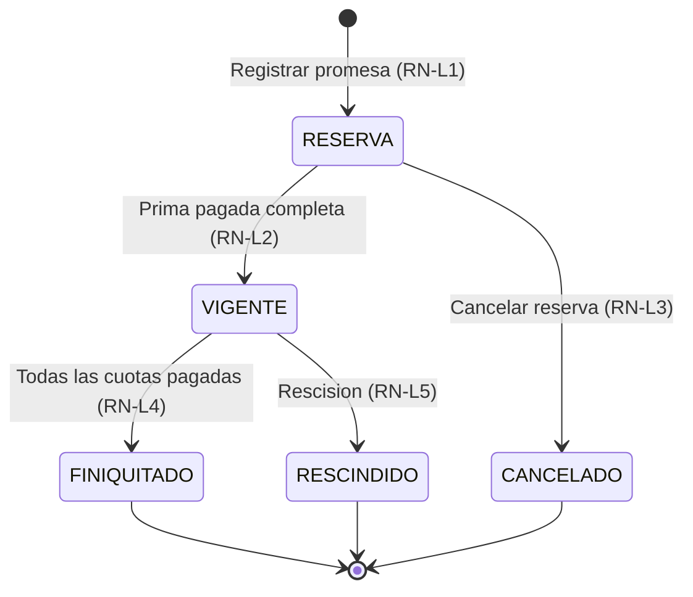

# 03.2 - Reglas de Negocio y Cálculos

Este documento especifica las reglas que el sistema debe cumplir, con ejemplos numéricos verificables. Cada regla tiene un código (`RN-xx`) para citarla desde el código y los tests. Las entidades y campos citados son los del [[03.1 - Esquema de Base de Datos y Entidades|Modelo v2]].

> [!WARNING] Parámetros pendientes de validación legal
> Días de gracia, recargos moratorios, tratamiento de la rescisión y tasas de interés deben revisarse contra la **Ley Especial de Lotificaciones y Parcelaciones para Uso Habitacional** y la **Ley contra la Usura** de El Salvador (ver D4 en [[04.2 - Plan de Corrección de Documentación]]). Por eso son **configurables por proyecto** y los valores mostrados aquí son solo de ejemplo.

---

## Caso de referencia

Todos los ejemplos financieros usan este contrato:

| Dato | Valor |
| :--- | :--- |
| Precio pactado | $20,400.00 |
| Prima pactada | $4,400.00 (1 cuota, de contado) |
| Saldo financiado ($S_0$) | $16,000.00 |
| Plazo ($n$) | 36 meses |
| Tasa anual ($r$) | 12 % |
| Fecha de firma | 2026-09-15 |
| Día de corte | 15 |
| Primer vencimiento de financiamiento | 2026-10-15 |

---

## 1. Motor Financiero

### RN-F1 · Tasa de interés
- La tasa pactada es **nominal anual**. La tasa del periodo es la **nominal mensual proporcional**: $i = \dfrac{r}{12 \times 100}$.
- Caso de referencia: $i = 0.01$ (1 % mensual).
- A modo informativo, el sistema muestra la **tasa efectiva anual** equivalente: $TEA = (1 + i)^{12} - 1$ → 12.68 %.
- Los intereses se calculan por periodo mensual completo, sin importar los días reales del mes (convención 30/360).

### RN-F2 · Tasa cero
- Si $i = 0$, la fórmula del Sistema Francés no se puede evaluar (división entre cero). En ese caso $C = S_0 / n$, igual que el Crédito Directo.
- El Sistema Alemán con $i = 0$ también produce cuotas iguales a $S_0 / n$.

### RN-F3 · Redondeo
1. Los cálculos internos se hacen en **centavos enteros** (o con aritmética decimal), nunca acumulando flotantes.
2. Redondeo a 2 decimales, **mitad hacia arriba** (0.005 → 0.01).
3. **Francés:** la cuota fija $C$ se redondea una sola vez. En cada periodo: interés $I_t = \text{red}(S_{t-1} \times i)$; capital $A_t = C - I_t$.
4. **Alemán y Directo:** capital fijo $A = \text{red}(S_0 / n)$.
5. **Última cuota:** el capital es exactamente el saldo restante, y la cuota es ese capital más su interés. Así absorbe las diferencias de redondeo y el saldo final es 0.00.

**Ejemplo — Sistema Francés** ($C = 531.43$):

| Cuota | Monto | Capital | Interés | Saldo |
| :--- | ---: | ---: | ---: | ---: |
| 1 | 531.43 | 371.43 | 160.00 | 15,628.57 |
| 2 | 531.43 | 375.14 | 156.29 | 15,253.43 |
| 3 | 531.43 | 378.90 | 152.53 | 14,874.53 |
| … | | | | |
| 35 | 531.43 | 520.96 | 10.47 | 526.11 |
| **36** | **531.37** | 526.11 | 5.26 | 0.00 |

Total de intereses: **$3,131.42**. Total pagado en financiamiento: $19,131.42.

**Ejemplo — Sistema Alemán** ($A = 444.44$):

| Cuota | Monto | Capital | Interés | Saldo |
| :--- | ---: | ---: | ---: | ---: |
| 1 | 604.44 | 444.44 | 160.00 | 15,555.56 |
| 2 | 600.00 | 444.44 | 155.56 | 15,111.12 |
| 3 | 595.55 | 444.44 | 151.11 | 14,666.68 |
| … | | | | |
| **36** | **449.05** | 444.60 | 4.45 | 0.00 |

Total de intereses: **$2,960.03**.

**Ejemplo — Crédito Directo:** cuotas 1–35 de **$444.44** y cuota 36 de **$444.60**. Intereses: $0.00.

### RN-F4 · Fechas de vencimiento
1. Las fechas se manejan como texto `YYYY-MM-DD` y se operan por año, mes y día. **No** se construyen con `new Date('YYYY-MM-DD')`, que las interpreta en UTC y en El Salvador (UTC−6) las corre al día anterior.
2. **Cuotas de prima:** la primera vence en `fechaFirma`; las siguientes, cada mes en la misma fecha.
3. **Cuotas de financiamiento:** la primera vence en `fechaPrimerVencimiento`. Por defecto es el día de corte del mes siguiente a la última cuota de prima (caso de referencia: 2026-10-15).
4. La cuota *k* vence *k − 1* meses después de la primera, en el día `min(diaCortePago, último día del mes)`.
   - Ejemplo con día de corte 31: 2027-01-31 → **2027-02-28** → 2027-03-31 → **2027-04-30**.

> [!SUCCESS] Corregido el 2026-09-30
> `amortization.ts` calcula en centavos y opera las fechas como año/mes/día. Las pruebas (`amortization.test.ts`) reproducen al centavo las tablas de esta sección y los días de corte 29–31.

> [!BUG] Diferencias que tenía el código anterior (`amortization.ts`)
> - Combina `new Date('YYYY-MM-DD')` (UTC) con `setDate()` (hora local) y `toISOString()` (UTC). Probado con zona horaria `America/El_Salvador`: con día de corte 15, **todas las cuotas vencen el día 16**.
> - `setDate(31)` en meses cortos se desborda al mes siguiente: un vencimiento del 31 de febrero de 2027 termina el **4 de marzo**.
> - No redondea la cuota francesa antes de calcular cada periodo.

### RN-F5 · Abono extraordinario a capital
1. Solo se admite cuando las cuotas vencidas y la cuota en curso están totalmente pagadas (el pago las cubre primero según RN-C1).
2. El monto reduce el saldo insoluto. Las cuotas de financiamiento pendientes se marcan `ANULADO` y se generan cuotas nuevas, que continúan la numeración y las fechas.
3. El administrador elige una de dos modalidades:
   - **Reducir plazo:** se mantiene la cuota y se recalcula el número de cuotas.
     - Francés: $n' = \left\lceil \dfrac{-\ln(1 - S \cdot i / C)}{\ln(1 + i)} \right\rceil$
     - Alemán: $n' = \lceil S / A \rceil$ · Directo: $n' = \lceil S / C \rceil$
   - **Reducir cuota:** se mantiene el plazo restante y se recalcula la cuota con el nuevo saldo.
4. Se registra un `EventoContrato` de tipo `ABONO_EXTRAORDINARIO` con el saldo, el plazo y la cuota antes y después, y la modalidad elegida.

**Ejemplo:** tras pagar la cuota 12 (saldo $11,289.34), el cliente abona **$2,000.00** a capital → nuevo saldo **$9,289.34**, con 24 cuotas restantes.

| Modalidad | Resultado | Intereses restantes |
| :--- | :--- | ---: |
| Sin abono | 24 cuotas de $531.43 | $1,464.92 |
| Reducir plazo | **20 cuotas** de $531.43 (la última, de $164.63) | $972.46 |
| Reducir cuota | 24 cuotas de **$437.28** | $1,205.43 |

### RN-F6 · Reestructuración
Cambiar tasa, plazo o sistema de un contrato vigente sigue el mismo mecanismo que RN-F5: se anulan las cuotas pendientes, se regeneran sobre el saldo actual y se registra un evento `REESTRUCTURACION` con las condiciones anteriores y las nuevas.

---

## 2. Cobranza

### RN-C1 · Aplicación de pagos (D7)
1. Las cuotas pendientes (`PENDIENTE` o `ABONO_PARCIAL`) se ordenan por `fechaVencimiento`. Si dos vencen el mismo día, va primero la de prima y luego la de menor número.
2. Antes de aplicar, se actualiza el recargo de cada cuota con la fecha del pago (RN-C2).
3. El pago recorre las cuotas en ese orden. En cada una cubre, en este orden:
   1. recargo pendiente (`recargoGenerado − recargoPagado`),
   2. interés pendiente (`abonoInteres − interesPagado`),
   3. capital pendiente (`abonoCapital − capitalPagado`).
4. Primero cubre **todas las cuotas vencidas** a la fecha del pago y después **la próxima cuota por vencer**.
5. Lo que sobra es el **excedente**, y el administrador decide su destino (`Pago.destinoExcedente`):
   - `SIGUIENTE_CUOTA`: sigue cubriendo las cuotas futuras en orden, sin descuento de intereses.
   - `ABONO_CAPITAL`: abono extraordinario según RN-F5.
6. Cada cuota tocada genera un `AplicacionPago`. El pago completo genera **un solo recibo**.
7. Estado de la cuota después de aplicar:
   - `PAGADO`: capital, interés y recargo cubiertos por completo (se registra `fechaPagoCompleto`).
   - `ABONO_PARCIAL`: recibió algún monto, pero no está completa.
   - `PENDIENTE`: no recibió nada.

**Ejemplo:** la cuota 5 (vencida el 2027-02-15) está impaga y la 6 vence el 2027-03-15. El cliente paga **$600.00** el **2027-03-10**. Configuración: 5 días de gracia y recargo único del 5 % sobre la cuota.

| Paso | Cuota | Recargo | Interés | Capital | Queda |
| :--- | :--- | ---: | ---: | ---: | ---: |
| Inicio | | | | | 600.00 |
| Cuota 5: 23 días de atraso → recargo 5 % × 531.43 = 26.57 | 5 | 26.57 | 144.92 | 386.51 | 42.00 |
| Cuota 6 (próxima por vencer) | 6 | 0.00 | 42.00 | 0.00 | 0.00 |

Resultado: la cuota 5 queda `PAGADO`; la cuota 6 queda `ABONO_PARCIAL` (le faltan $99.05 de interés y $390.38 de capital). El recibo muestra recargo $26.57, interés $186.92, capital $386.51, saldo anterior $14,491.85 y saldo resultante **$14,105.34**.

> [!NOTE] Implementación actual (modelo v1, 2026-09-30)
> Pagos parciales y pagos que cubren varias cuotas, de la más antigua a la más reciente, con el desglose interés/capital guardado en el recibo (`pagos.ts`). Aún sin recargos (RN-C2) ni abono extraordinario a capital (RN-F5). Un pago que supera lo pendiente se rechaza.

### RN-C2 · Mora y recargos
1. Una cuota está **en mora** si no está pagada y `fecha > fechaVencimiento + diasGracia`. Es un valor derivado (ver [[03.1 - Esquema de Base de Datos y Entidades]], sección 5).
2. **Días de atraso** = `fecha − fechaVencimiento`.
3. **Recargo devengado** a una fecha dada, según `ConfiguracionCobranza`:
   - Base: `montoCuota` programado de la cuota.
   - `PORCENTAJE`: `valorRecargo % × base` · `MONTO_FIJO`: `valorRecargo`.
   - `UNICO`: se cobra una vez desde que la cuota entra en mora.
   - `MENSUAL`: se cobra una vez por cada 30 días de atraso después de la gracia: $\left\lfloor \dfrac{\text{atraso} - \text{gracia} - 1}{30} \right\rfloor + 1$ veces.
4. **Cuándo se guarda:** `Cuota.recargoGenerado` solo se actualiza al aplicar un pago, calculado a la **fecha del pago** (queda en el mayor valor entre el guardado y el calculado). Las pantallas muestran el recargo **estimado a hoy** sin guardarlo. Así, un pago registrado con fecha pasada no arrastra recargos que no correspondían.
5. Valores por defecto sugeridos (**sin validar legalmente**): 5 días de gracia, recargo `PORCENTAJE` de 5 %, `UNICO`.
6. Condonar recargos queda fuera del alcance del Modelo v2.

### RN-C3 · Folios de recibos (D5)
1. Formato: `{prefijoFolio}-{AAAA}-{NNNN}`, con el número relleno con ceros a 4 dígitos (si pasa de 9999, usa los dígitos que necesite).
2. `AAAA` es el año de `fechaEmision`, que es la fecha en que se **registra** el pago (no la fecha del pago).
3. El número sale de `ContadorFolio` (`${proyectoId}-${anio}`): se lee `ultimoNumero`, se suma 1 y se guarda **en la misma transacción** que el pago y el recibo. Si el contador del año no existe, se crea en 0.
4. `prefijoFolio`: de 2 a 5 letras mayúsculas, único entre proyectos y fijo desde que el proyecto emite su primer recibo.
5. Los recibos no se borran. Un recibo anulado conserva su folio y ese número no se vuelve a usar.

### RN-C4 · Anulación de pagos

> [!NOTE] Implementado el 2026-09-30 (`storage.anularRecibo`)
> El recibo de prima no se anula por esta vía. Los repartos del cobro anulado quedan marcados `anulada` y dejan de contar en saldos y reembolsos.
1. Solo se puede anular el **último pago no anulado** de un contrato. Para anular uno anterior, primero hay que anular los posteriores.
2. Al anular: `Pago.anulado = true`; el recibo pasa a `ANULADO` con motivo y fecha; los campos pagados de las cuotas se recalculan con las aplicaciones de pagos no anulados (invariante 4 de 03.1) y se revierten los cambios de estado de contrato y lote que el pago hubiera provocado.
3. Si el pago incluía un abono extraordinario, se anulan las cuotas regeneradas y se reactivan las anteriores.
4. Se registra un evento `PAGO_ANULADO`.

### RN-C5 · Estado de cuenta del cliente
Se evalúa por contrato, y el cliente toma el peor estado de sus contratos. Prioridad de mayor a menor:

| Estado | Condición |
| :--- | :--- |
| **En mora** | Al menos una cuota en mora (RN-C2). |
| **Vencido (en gracia)** | Al menos una cuota vencida sin pagar, todavía dentro de los días de gracia. |
| **Próximo a vencer** | Una cuota impaga vence dentro de `diasAvisoVencimiento` días (por defecto 7). |
| **Al día** | Ninguna de las anteriores. |

Para el Dashboard ([[02.6 - Dashboard y Analítica Administrativa]]), la morosidad se agrupa por días de atraso con `umbralesMoraDias` (por defecto `[15, 30]`): **1–15**, **16–30** y **más de 30** días.

---

## 3. Ciclo de Vida del Contrato y del Lote

| Estado del contrato | Estado del lote |
| :--- | :--- |
| `RESERVA` | `RESERVADO` |
| `VIGENTE` | `VENDIDO` |
| `FINIQUITADO` | `FINIQUITADO` |
| `CANCELADO` / `RESCINDIDO` | `DISPONIBLE` |

### RN-L1 · Registrar una promesa de venta
- **Validaciones:**
  - El lote está `DISPONIBLE` y no tiene otro contrato en `RESERVA` o `VIGENTE`.
  - `0 ≤ primaPactada < precioPactado`, `cuotasPrima ≥ 1`, `plazoMeses ≥ 1` y `1 ≤ diaCortePago ≤ 31`.
  - `fechaLimiteReserva` ≥ vencimiento de la última cuota de prima. Por defecto es `fechaFirma + diasReservaPorDefecto`, o ese vencimiento si es posterior.
- **Efectos** (una sola transacción):
  - Se crea el contrato en `RESERVA` y el lote pasa a `RESERVADO`.
  - Se generan las cuotas `PRIMA` (prima dividida en partes iguales; la última absorbe el redondeo) y todas las cuotas de `FINANCIAMIENTO`.
  - Se registra el evento `RESERVA_CREADA`.

### RN-L2 · Prima completada
Cuando todas las cuotas `PRIMA` quedan `PAGADO`, en la misma transacción del pago: el contrato pasa a `VIGENTE`, el lote a `VENDIDO`, y se registra el evento `PRIMA_COMPLETADA`.

### RN-L3 · Reserva vencida
- Si hoy es posterior a `fechaLimiteReserva` y el contrato sigue en `RESERVA`, el Dashboard muestra una alerta. **El sistema no cancela automáticamente.**
- El administrador puede:
  - **Prorrogar:** fija una nueva fecha límite y se registra `PRORROGA_RESERVA`.
  - **Cancelar:** el contrato pasa a `CANCELADO`, el lote a `DISPONIBLE`, las cuotas pendientes a `ANULADO`, y se registra `CANCELACION_RESERVA` con `{ totalPagado, montoDevuelto, montoRetenido, motivo }`.

### RN-L4 · Finiquito
Cuando todas las cuotas de `FINANCIAMIENTO` quedan `PAGADO`: el contrato y el lote pasan a `FINIQUITADO` y se registra el evento `FINIQUITO`. La escrituración y la inscripción en el CNR ocurren fuera del sistema.

### RN-L5 · Rescisión
- Acción manual del administrador sobre un contrato `VIGENTE`, con motivo obligatorio.
- El contrato pasa a `RESCINDIDO`, el lote a `DISPONIBLE` (conserva su polígono) y las cuotas pendientes a `ANULADO`. Las cuotas pagadas y sus recibos no se modifican.
- Se registra el evento `RESCISION` con `{ totalPagado, montoDevolver, montoRetenido, motivo }`. El administrador define la división según el contrato y la ley; **el sistema no la calcula** hasta que haya validación legal.
- Las devoluciones de dinero (egresos) no se modelan como `Pago`; solo quedan en el evento.

---

## 4. Geoespacial

### RN-G1 · Formatos de coordenadas
- **Decimal:** `13.692000, -89.218000`.
- **Grados, minutos y segundos (GMS):** $\text{decimal} = \pm(g + m/60 + s/3600)$. Las coordenadas al Sur o al Oeste son negativas.
  - Ejemplo: `13°41'31.2" N, 89°13'04.8" W` → `13.692000, -89.218000`.
- **Validación:** si un vértice cae fuera del rango aproximado de El Salvador (latitud 13.1 a 14.5, longitud −90.2 a −87.6), el sistema **advierte** pero no bloquea.
- **Lambert El Salvador** (Norte/Este en metros, típico de las escrituras del CNR): se admite como punto de partida y se convierte a WGS84 con `lambertElSalvadorToWGS84()` (verificado contra la definición oficial, diferencia < 3 cm).
  - Supone el datum **SIRGAS-ES2007**. Escrituras antiguas referidas a un datum anterior pueden quedar desplazadas; ante la duda, verificar con un punto conocido.
  - Rango aceptado: Norte entre 100 000 y 400 000 m, Este entre 300 000 y 800 000 m.

### RN-G2 · Rumbos y distancias
> [!IMPORTANT] El primer punto es el punto de partida (2026-10-03, indicación del administrador)
> Los documentos no dicen explícitamente "de aquí se parte". **El primer punto que aparece con coordenadas es siempre el punto de partida**, donde empieza el tramo 1, se llame como se llame ("mojón uno", "vértice Nor Poniente", "Punto 1"…) y esté donde esté (en el texto o en un cuadro de coordenadas del plano). Esto vale para:
> - coordenadas Lambert como Norte/Este o como Y/X (Y es Norte y X es Este); si vienen intercambiadas, se corrigen con aviso;
> - un cuadro con las coordenadas de todos los vértices: el primero es el punto de partida y, si no hay tramos, el polígono se dibuja con el cuadro;
> - latitud y longitud: la primera es el punto de partida (`ubicadoPor: 'DOCUMENTO'`).

> [!NOTE] Tramos verificados con varias lecturas (2026-10-03)
> El cierre detecta los errores de lectura grandes, pero no los pequeños (un minuto mal leído en un tramo corto mueve el cierre milímetros). Por eso los tramos se leen al menos dos veces y se comparan; ver [[02.1 - Ingesta y Procesamiento de Promesas de Venta]].
> [!NOTE] Sin punto de partida (2026-10-01)
> Si la escritura no trae las coordenadas del punto de partida, los tramos se guardan con el lote y el lote queda **sin ubicar** hasta que se indique ese punto con su coordenada Lambert o marcándolo en el mapa (aproximado). Mientras tanto se revisan igual el cierre y el área. Ver [[02.2 - Módulo Geoespacial y Cartografía]] §4.

1. **Entrada:** un punto de arranque (lat/lng) y una lista de tramos `{ rumbo, distancia en metros }`. Rumbo en formato `N 10°00'00" E`.
2. **Rumbo → azimut** (θ = ángulo del rumbo):

   | Cuadrante | Azimut |
   | :--- | :--- |
   | N … E | θ |
   | S … E | 180° − θ |
   | S … W | 180° + θ |
   | N … W | 360° − θ |

3. **Cálculo en plano local** (válido para lotes de menos de 1 km): $\Delta E = d \sin(Az)$ y $\Delta N = d \cos(Az)$, acumulados desde el arranque. Luego se convierte a coordenadas geográficas con $R = 6\,378\,137$ m:
   - $lat = lat_0 + \dfrac{N}{R} \cdot \dfrac{180}{\pi}$
   - $lng = lng_0 + \dfrac{E}{R \cos(lat_0)} \cdot \dfrac{180}{\pi}$
4. **Error de cierre:** $e$ = distancia entre el punto final calculado y el de arranque; **precisión** = $e / \text{perímetro}$.
   - Precisión ≤ 1/1000: se acepta.
   - Precisión > 1/1000: advertencia, y el administrador confirma o corrige.
   - En ambos casos el polígono se cierra uniendo el último vértice con el primero.

**Ejemplo:** arranque en `13.692000, -89.218000`.

| Tramo | Rumbo | Distancia | Vértice resultante |
| :--- | :--- | ---: | :--- |
| 1 | N 10°00'00" E | 20.00 m | 13.6921769, -89.2179679 |
| 2 | S 80°00'00" E | 17.00 m | 13.6921504, -89.2178131 |
| 3 | S 10°00'00" W | 20.00 m | 13.6919735, -89.2178452 |
| 4 | N 80°00'00" W | 17.00 m | cierra en el arranque |

El error de cierre es 0.00 m y el área, **340.00 m²**. Si el último tramo midiera 16.80 m, el error sería 0.20 m y la precisión 1/369, por lo que el sistema advertiría.

**Caso real verificado (2026-09-27):** una segregación de 22 tramos cierra a 0.014 m (1/11 370) con 1,319.88 m² frente a 1,319.67 m² de la escritura. Es una prueba automática en `geoElSalvador.test.ts` (origen desplazado, sin datos personales).

**Implementación:** `parseRumbo()` acepta Norte/Sur, Este/Oriente, Oeste/Poniente/O con límites de palabra (un error anterior leía "Oeste" como "Este") y **rechaza** los rumbos ilegibles. La extracción pide a la IA los tramos ya descompuestos (`inicio`, `grados`, `minutos`, `segundos`, `fin`, `distancia`).

### RN-G3 · Área, centroide y conversión de unidades
- **Área:** fórmula del polígono (*shoelace*) sobre los vértices en plano local (RN-G2).
- **Comparación con el área del contrato:** $\Delta = |A_{calc} - A_{contrato}| / A_{contrato}$.
  - ≤ 2 %: aceptado.
  - 2–5 %: advertencia.
  - > 5 %: requiere confirmación explícita.
- **Varas cuadradas:** 1 vara = 0.835905 m → **1 v² = 0.698737 m²**. Ejemplo: 340.00 m² = **486.59 v²**.
- **Centroide:** centroide del polígono en plano local, convertido a lat/lng. Es el punto donde se ancla la etiqueta del lote en el mapa.

---

## 5. Ingesta Documental

### RN-I1 · Estado actual y flujo objetivo
- **Hoy:** extracción real con Google Gemini a través del proxy local de Vite ([[ADR-010 - Extracción documental con Google Gemini API y conversión geodésica|ADR-010]], reemplaza a D3). El documento **no se guarda** todavía.
- **Flujo objetivo:** cargar el archivo → guardarlo como `Documento` (requiere Dexie) → extraer los datos → validar en pantalla dividida → confirmar (RN-L1).

### RN-I2 · Umbrales de confianza
Cada grupo de campos (partes, financiero, coordenadas) tiene una confianza de 0 a 100:

| Confianza | Comportamiento |
| :--- | :--- |
| ≥ 85 | Campo precompletado. |
| 60–84 | Campo precompletado y resaltado; hay que confirmarlo explícitamente. |
| < 60 | Campo vacío; se captura a mano. |

### RN-I3 · Validaciones antes de confirmar
- **DUI:** formato `00000000-0`. Dígito verificador: $\text{dv} = (10 - (\sum_{k=1}^{8} d_k \cdot (10 - k)) \bmod 10) \bmod 10$, con pesos del 9 al 2. Ejemplo: `04512378-8`. El algoritmo se comprobó con dos DUI reales de una escritura (2026-09-27) y **bloquea la confirmación** si no coincide (`validaciones.ts`).
- **NIT:** formato `0000-000000-000-0`.
- **Teléfono:** `+503` seguido de 8 dígitos.
- **Lote:** `codigoLote` existe en el proyecto y está `DISPONIBLE`.
- **Coherencia financiera y geográfica:** reglas de RN-L1, RN-G1 y RN-G3.
- **Tipo de documento:** la extracción clasifica el archivo (promesa, compraventa, remedición, segregación u otro). Si no es una promesa ni una compraventa, avisa que probablemente se subió el archivo equivocado.
- **Implementado al registrar (2026-10-01, `validarPromesaVenta` en `storage.ts`):** si algo falla, **no se guarda nada** y se muestra el motivo:
  - Comprador y código de lote no vacíos.
  - Precio > 0 (no se registran ventas de $0), `0 ≤ prima ≤ precio` y fecha de firma válida.
  - Si queda saldo: plazo entero ≥ 1, día de pago de 1 a 31 y tasa ≥ 0.
  - El lote no tiene otra promesa registrada. El lote se reconoce por su código sin distinguir tildes, mayúsculas ni espacios ("Porcion  uno" = "PORCIÓN UNO").
  - No es la misma promesa subida otra vez: se rechaza si coinciden el comprador (DUI), el precio y el área (±1 m²) de un contrato existente, aunque el código del lote se haya leído distinto.
  - La negociación vinculada sigue abierta o en espera (no convertida ni cancelada).
  - Cada gasto de la venta es válido (antes los inválidos se descartaban en silencio).

---

## 6. Sucesión: Gastos de Venta y Reparto a Beneficiarios

Decisiones en [[ADR-011 - Reparto de cobros a beneficiarios y reembolso de gastos]]. Implementado en `src/modules/beneficiarios/engine/reparto.ts` con pruebas.

### RN-B1 · Base del reparto
Se reparte **lo efectivamente cobrado** de un lote de un proyecto con beneficiarios válidos: la **prima** (al confirmar la promesa) y **cada cuota** (al registrar su pago). Si el proyecto no tiene beneficiarios que sumen 100 %, el cobro queda en "Cobros sin repartir" hasta repartirlo manualmente.

### RN-B2 · Reembolso de gastos
Antes de repartir, cada cobro reembolsa los gastos **a cargo de la sucesión** de esa venta que sigan pendientes, en orden de fecha, a su **responsable**. Normalmente los cubre la prima; si no alcanza, el saldo sale de los cobros siguientes. Los gastos **a cargo del comprador** no se reembolsan ni se descuentan.

### RN-B3 · Partes y centavos
Parte de cada beneficiario = neto × porcentaje ÷ suma de porcentajes, **redondeada hacia abajo** al centavo. Los centavos sobrantes se asignan uno a uno **en rotación**, empezando por el beneficiario siguiente al que recibió el último centavo en ese proyecto.

### RN-B4 · Porcentajes
Los porcentajes de los beneficiarios activos deben sumar **100 %** (tolerancia 0.001). "Partes iguales" asigna 100/n con precisión completa. Un cambio de porcentaje solo afecta a los cobros futuros. Un beneficiario con repartos no se elimina: se desactiva.

### RN-B5 · Saldos y entregas
Pendiente de cada persona = partes repartidas + reembolsos − entregas. Una entrega no puede superar lo pendiente.

**Por lote vendido (2026-10-03):** los saldos se llevan **por venta**, para no mezclar el dinero de una venta con el de otra. Cada venta suma sus propios repartos y reembolsos. Cada entrega sale de **una** venta (`Liquidacion.contratoId` y `loteId`) y no puede superar lo pendiente de esa persona **en esa venta**, aunque en total tenga más. "Entregar a todos" se hace por lote: una entrega con folio por persona. Las entregas anteriores, sin venta, se aplican por fecha a las ventas más antiguas de la persona que tengan saldo. La suma de todas las ventas es igual al saldo total de la persona (`calcularSaldosPorVenta` y `calcularSaldos` en `src/modules/beneficiarios/engine/reparto.ts`).

**Ejemplo (cifras ficticias, 7 beneficiarios iguales):** prima de $5,000.00 con gastos de la sucesión de $600.00 (gestión, responsable: beneficiario 1) y $400.00 (abogado, responsable externo):

| Cobro | Reembolsos | Neto | Partes |
| :--- | ---: | ---: | :--- |
| Prima $5,000.00 | $1,000.00 | $4,000.00 | Beneficiarios 1–6: $571.43 · beneficiario 7: $571.42 |
| Cuota $1,250.00 | — | $1,250.00 | Beneficiario 7: $178.58 · resto: $178.57 |

Pendiente del beneficiario 1 tras la prima: $571.43 + $600.00 de reembolso = **$1,171.43**.

### RN-N1 · Ciclo de una negociación
*En negociación* → **Completada** → *Esperando promesa* → al registrar la promesa vinculada → *Convertida en venta*. Desde *En negociación* o *Esperando promesa* se puede **Cancelar**; desde *Esperando promesa* se puede **Reabrir**. [[ADR-012 - Negociaciones previas a la venta]]

### RN-N2 · Gastos de la negociación
Se registran sin venta (`negociacionId`, sin `contratoId`) y no se reembolsan mientras la negociación esté abierta. Al convertirse, pasan al contrato y la prima los reembolsa según RN-B2.

### RN-N3 · Cancelación
El administrador elige quién asume los gastos:
- **Sucesión:** se reembolsan a su responsable con la **próxima prima** cobrada en el proyecto, después de los gastos propios de esa venta.
- **Responsable:** quedan `aCargoDe = RESPONSABLE` y no se reembolsan.

### RN-N4 · Reserva del lote
Al marcarla completada, el lote elegido (si existe y está disponible) pasa a *Reservado* a nombre del interesado. Al cancelar o reabrir vuelve a *Disponible* si no tiene contrato. Si la promesa se registra sobre otro lote, la reserva original se libera.

---

Enlaces relacionados:
- Modelo de datos: [[03.1 - Esquema de Base de Datos y Entidades]]
- Motor financiero: [[02.3 - Motor Financiero y Amortización]]
- Cobranza: [[02.5 - Clientes, Cobranza y Recibos]]
- Cartografía: [[02.2 - Módulo Geoespacial y Cartografía]]
- Ingesta: [[02.1 - Ingesta y Procesamiento de Promesas de Venta]]
- Inventario: [[02.4 - Inventario y Gestión de Proyectos]]
