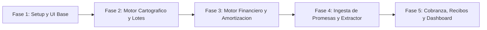

# 04.1 - Fases de Implementación y Plan de Desarrollo

Este documento desglosa la construcción técnica de la plataforma **CrediLote** en fases secuenciales orientadas a entregas funcionales, y registra el **avance real** verificado contra el código en `src/`.

> [!NOTE] Estado general (actualizado al 2026-09-27)
> Existe un **esqueleto funcional con extracción real por IA** (Gemini a través de un proxy local) y conversión geodésica de El Salvador (Lambert / CNR). El 2026-09-27 se corrigió el error que dibujaba mal los polígonos ("Oeste" leído como "Este") y se agregaron control de cierre y área, tabla de tramos editable y pruebas automáticas. Los pendientes se concentran en persistencia Dexie.js, privacidad de Gemini, mora y pagos parciales.
>
> Leyenda: `[x]` hecho · `[~]` parcial (ver nota) · `[ ]` pendiente

| Fase | Avance | Resumen |
| :--- | :--- | :--- |
| 1. Setup y UI Base | 🟢 Avanzado | Layout, componentes y datos semilla preconfigurados; persistencia en `localStorage`. |
| 2. Cartografía | 🟢 Avanzado | Mapa satelital, capas, auto-encuadre `fitBounds`, conversión Lambert CNR y cálculo de rumbos/distancias. |
| 3. Motor Financiero | 🟢 Casi completa | 3 sistemas y simulador listos; soporte de crédito directo sin interés automático. |
| 4. Ingesta de Promesas | 🟡 Casi completa | Extracción con Gemini vía proxy, descripción técnica editable con mini mapa y validaciones. Falta guardar el documento y las condiciones de privacidad. |
| 5. Cobranza y Dashboard | 🟡 Parcial | Registro de pagos, recibos y KPIs listos; faltan mora, pagos parciales y respaldo. |
| 8. Sucesión y beneficiarios | 🟢 Implementada | Beneficiarios con porcentajes, gastos de venta amarrados a cada lote, reparto de la prima y las cuotas, entregas con comprobante, y negociaciones previas a la venta. Ver [[04.3 - Plan Sucesión, Beneficiarios y Gastos de Venta]]. |

---

## Desglose de Fases de Construcción

### Fase 1: Arquitectura Base e Interfaz Administrativa
- [x] Especificación y documentación en Obsidian Vault.
- [x] Inicialización del proyecto (Vite + React + TypeScript + Tailwind CSS + Lucide React).
- [x] Layout principal: `AppShell` con barra lateral, selector y creación de proyectos, navegación por pestañas.
- [x] Catálogo de componentes base propios (`DataGrid`, `PropertyList`, `Drawer`, `Modal`, `MetricCard`, `Badge`, `Button`, `Card`).
- [~] Colores de estado: definidos en cada componente; los tokens de `tailwind.config.js` no se usan (ver [[01.3 - Sistema de Diseño y UI]]).
- [~] Capa de persistencia: implementada con `localStorage`; **migración a Dexie.js (IndexedDB) pendiente**.
- [x] Datos de ejemplo (Honduras) retirados el 2026-09-27: la app arranca vacía; `seedData.ts` solo se usa para identificar y borrar esos datos en instalaciones antiguas.
- [x] Configuración de control de versiones y seguridad: `.gitignore` creado para proteger credenciales y variables de entorno.
- [x] Pruebas automáticas con Vitest (`npm test`): geodesia y validaciones.
- [ ] Exportación / importación de respaldo en JSON (adelantada desde la Fase 5 por riesgo de pérdida de datos).

### Fase 2: Motor Geoespacial y Cartografía de Terrenos
- [x] Integración de Leaflet con capa satelital (Esri World Imagery) y cartografía base (OpenStreetMap), con alternancia.
- [x] Polígonos por lote con color por estado (Verde = Disponible, Ámbar = Reservado, Rojo = Vendido, Azul = Finiquitado).
- [x] Filtro de lotes por estado en el mapa.
- [x] Auto-encuadre de cámara: `map.fitBounds()` ajusta automáticamente el zoom al lote o conjunto de parcelas.
- [x] Soporte de coordenadas catastrales oficiales de El Salvador: conversión de coordenadas métricas Lambert / CNR (EPSG 5373) a WGS84 GPS en `geoElSalvador.ts`.
- [x] Trazado de polígonos a partir de rumbos y distancias (RN-G2), con **error de cierre y área** (RN-G3). Corregido el 2026-09-27: "Oeste" se leía como "Este".
- [x] Sanitización anti-XSS en tooltips dinámicos de Leaflet.
- [x] Pin con el código del lote en el centroide, selector "Ir a lote", lote resaltado y enfoque automático tras registrar una promesa (2026-09-27).
- [x] Panel lateral (`Drawer`) con ficha técnica del lote y resumen del contrato.
- [ ] Modificación manual interactiva de vértices en el mapa (drag-and-drop de nodos).
- [ ] Alta y edición manual de lotes desde el inventario.

### Fase 3: Motor Financiero y Amortización Dinámica
- [x] Algoritmos: Sistema Francés (cuota fija), Crédito Directo sin intereses y Sistema Alemán (`amortization.ts`).
- [x] Tabla de amortización con capital, interés y saldo insoluto.
- [x] Simulador de financiamiento con ajuste de precio, prima, plazo, tasa y sistema.
- [x] Impresión de la tabla de amortización (vía navegador).
- [ ] Abonos extraordinarios con recálculo por reducción de plazo o de cuota.
- [ ] Tests unitarios del motor con casos numéricos de referencia.

### Fase 4: Ingesta y Procesamiento de Promesas de Venta
- [x] Componente de carga arrastrar-y-soltar (`Dropzone`) para PDF e imágenes (PNG, JPG, WebP) con selector de archivos nativo.
- [x] Extractor de entidades real con IA Multimodal (Google Gemini) con cascada de 5 modelos (ver [[02.1 - Ingesta y Procesamiento de Promesas de Venta|02.1]]); reintenta cada modelo una vez ante errores temporales (429/500/503) y abandona intentos de más de 150 s.
- [x] Clave de Gemini fuera del cliente: proxy local del servidor de Vite (`GEMINI_API_KEY`).
- [x] Interpretación especializada de solemnidad notarial salvadoreña: conversión de cantidades y DUIs escritos enteramente en letras a valores numéricos normalizados.
- [x] Visor documental en vivo integrado: visualización nativa de PDF mediante `<iframe>` y de escaneos/imágenes con zoom interactivo (70% - 150%).
- [x] Formulario de verificación editable con indicadores de certeza (Partes, Financiero, GPS) con umbrales 85/60 (RN-I2).
- [x] Descripción técnica editable: mojón 1 (Lambert), tabla de tramos, avisos de cierre y área, y mini mapa de vista previa.
- [x] Validaciones: DUI con dígito verificador, teléfono +503, tipo y tamaño de archivo (máx. 15 MB).
- [x] Registro de la promesa: crea cliente (DUI salvadoreño), contrato, actualiza el lote a `VENDIDO` y genera la tabla de amortización.
- [x] Proyección de coordenadas al mapa desde el mojón Lambert y los tramos. Si solo hay mojón, el lote queda sin polígono (ya no se dibuja un cuadrado ficticio).
- [ ] Guardar el documento cargado (depende de Dexie).
- [ ] Condiciones de privacidad para enviar contratos a Gemini (01.4 §2).

### Fase 5: Cobranza, Emisión de Recibos y Tablero Ejecutivo
- [x] Registro de pagos con método, referencia bancaria y fecha.
- [x] Recibos con folio consecutivo, imprimibles desde el navegador.
- [~] Folio: formato `REC-2026-NNNN` con año fijo y numeración basada en el total de recibos (ver regla pendiente D5).
- [ ] Pagos parciales y excedentes (hoy todo pago marca la cuota como `PAGADO`).
- [ ] Cálculo automático de mora y recargos.
- [x] Dashboard con KPIs: lotes vendidos, primas recaudadas, cartera por cobrar y recaudación cobrada.
- [~] Alertas de vencimientos: lista de cuotas a 30 días (la especificación de [[02.6 - Dashboard y Analítica Administrativa]] pide 7 días y vencimientos del día).
- [ ] KPIs de tasa de colocación, eficiencia de cobranza e índice de morosidad.
- [ ] Miniatura cartográfica en el dashboard (hoy hay un acceso directo al mapa).

---

> [!NOTE] Siguiente paso
> Antes de continuar con funcionalidades nuevas, completar las correcciones de documentación y modelo de datos descritas en [[04.2 - Plan de Corrección de Documentación]], y priorizar el **respaldo JSON** y la **migración a Dexie.js**.

Enlaces relacionados:
- [[00 - Índice General (MOC)]]
- [[04.2 - Plan de Corrección de Documentación]]
