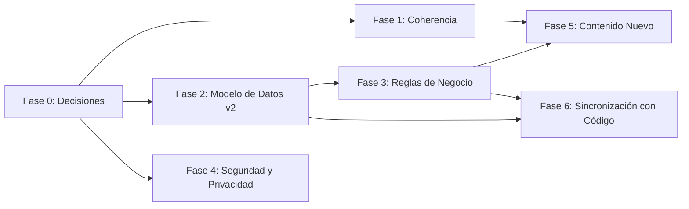

# 04.2 - Plan de Corrección de Documentación

Plan de trabajo para corregir las inconsistencias, vacíos y desalineaciones detectadas en la revisión del vault (2026-09-26) frente al código en `src/`.

> [!NOTE] Convención
> Tamaño estimado: **S** (< 1 h), **M** (1–3 h), **L** (> 3 h). Cada tarea indica la nota afectada y su criterio de cierre.

---

## Fase 0 — Decisiones bloqueantes

Sin estas decisiones no se puede escribir la documentación correcta. Registrar cada una como ADR (ver Fase 5).

- [x] **D1. Librería de UI** — ¿Saas UI/Chakra o Tailwind + componentes propios (lo que existe hoy)?
  - ✅ **Decidido (2026-09-26): Tailwind + componentes propios** inspirados en patrones Saas UI. Evita migrar código y la colisión Chakra/Tailwind.
- [x] **D2. Persistencia** — ¿localStorage (actual) o Dexie/IndexedDB (documentado)?
  - ✅ **Decidido (2026-09-26): Dexie/IndexedDB**. localStorage (~5 MB) no admite PDFs adjuntos ni crecimiento de cartera.
- [x] **D3. Extracción documental** — ¿Gemini (vía proxy/backend), Tesseract.js local, o mantener simulación en esta etapa?
  - ✅ **Decidido (2026-09-26):** documentar explícitamente que hoy es **simulada**; si se usa Gemini, que sea mediante proxy para no exponer la API key.
  - 🔄 **Reemplazada (2026-09-27)** por [[ADR-010 - Extracción documental con Google Gemini API y conversión geodésica|ADR-010]]: extracción real con Gemini. El proxy quedó pendiente (tarea 7.8).
- [x] **D4. Contexto regional** — País objetivo, moneda, identificación, marco legal.
  - ✅ **Decidido (2026-09-26): El Salvador.**
    - Moneda por defecto: **USD** (economía dolarizada).
    - Identificación de personas: **DUI** (formato `00000000-0`). El DUI también funciona como NIT para personas naturales; el **NIT** (`0000-000000-000-0`) se conserva para personas jurídicas (vendedor / lotificadora).
    - Teléfono: prefijo **+503**, 8 dígitos (`0000-0000`).
    - Unidad de área tradicional: **vara cuadrada** (1 v² ≈ 0.6987 m²).
    - División territorial: departamento → municipio → distrito.
    - Coordenadas de referencia: San Salvador (13.6929, -89.2182).
  - ⚠️ **A verificar con asesoría legal/contable** antes de la Fase 3:
    - Ley Especial de Lotificaciones y Parcelaciones para Uso Habitacional: requisitos del contrato, mora y rescisión.
    - Ley contra la Usura: tasas máximas aplicables a intereses y recargos moratorios.
    - Facturación electrónica (DTE) del Ministerio de Hacienda: si los recibos de CrediLote son comprobantes internos o si cada cobro requiere un documento tributario.
    - Inscripción de la propiedad en el CNR al escriturar (estado `FINIQUITADO`).
- [x] **D5. Política de folios**
  - ✅ **Decidido (2026-09-26): por proyecto y por año.** Formato `PREFIJO-AAAA-NNNN` (p. ej. `PIN-2026-0001`). Cada proyecto define su prefijo; el contador reinicia cada año calendario, se guarda de forma persistente (no se calcula contando recibos) y los folios anulados nunca se reutilizan.
- [x] **D6. Transición Reservado → Vendido**
  - ✅ **Decidido (2026-09-26): al liquidar la prima.** Registrar la promesa deja el lote en `RESERVADO`; pasa a `VENDIDO` cuando la prima está pagada por completo. Se permite pagar la prima en abonos. La reserva tiene fecha límite; si vence sin completar la prima, el administrador decide si cancela (vuelve a `DISPONIBLE`) o la prorroga.
- [x] **D7. Orden de aplicación de pagos**
  - ✅ **Decidido (2026-09-26): recargo moratorio → interés → capital**, cubriendo primero las cuotas más antiguas. El excedente se aplica a la siguiente cuota o como abono extraordinario a capital, según elija el administrador en cada pago.

**Cierre:** las 7 decisiones registradas con fecha y justificación. ✅ Fase 0 completada (2026-09-26).

### Tareas derivadas de D4 (El Salvador)

La documentación y el código usan hoy ejemplos de Honduras. Se corrigen en las fases indicadas:

- [x] **D4.1** Reemplazar ejemplos hondureños en las notas (DNI `0801-…`, `+504`, HNL, coordenadas de Tegucigalpa) por equivalentes salvadoreños: [[02.1 - Ingesta y Procesamiento de Promesas de Venta]], [[02.4 - Inventario y Gestión de Proyectos]], [[03.1 - Esquema de Base de Datos y Entidades]]. — Fase 2/3, S
- [x] **D4.2** Renombrar el campo `dniIdentificacion` a `dui` (y añadir `nit` para personas jurídicas) en el modelo de datos v2. — Fase 2, S
- [x] **D4.3** Añadir `departamento`, `municipio` y `distrito` a `Proyecto`. — Fase 2 (tarea 2.5), S
- [ ] **D4.4** Validaciones de formato DUI, NIT y teléfono +503 en formularios. — Fase 6, S
- [x] **D4.5** Código: moneda por defecto USD, coordenadas por defecto de San Salvador en `Sidebar.tsx` (13.6929, -89.2182), contrato de ejemplo en `ContractsView.tsx`. — Fase 6, S
- [x] **D4.6** Sección de contexto regional y marco legal en [[01.1 - Visión y Objetivos]]. — Fase 5 (tarea 5.3), S

---

## Fase 1 — Coherencia inmediata entre notas (sin cambios de fondo)

| # | Tarea | Nota | Tamaño |
|---|---|---|---|
| ✅ 1.1 | Unificar stack según D1/D2/D3: diagrama y tabla idénticos, eliminar Zustand/Chakra si no aplican, jsPDF vs `window.print`. | [[01.2 - Arquitectura y Stack Tecnológico]] | M |
| ✅ 1.2 | Reescribir el sistema de diseño según D1: tabla componente → archivo real en `src/shared/components/ui/`, tokens en formato Tailwind. Renombrar nota si deja de ser "SaaS UI". | [[01.3 - Sistema de Diseño y UI]] | M |
| ✅ 1.3 | Unificar nombres de estados del lote (`VENDIDO` en lugar de `VendidoEnPago`) y agregar **Finiquitado (azul)** a la tabla de colores. | [[02.2 - Módulo Geoespacial y Cartografía]], [[02.4 - Inventario y Gestión de Proyectos]] | S |
| ✅ 1.4 | Definir el KPI "tasa de colocación" (lotes vendidos / lotes totales) o quitarlo del MOC. | [[02.6 - Dashboard y Analítica Administrativa]], MOC | S |
| ✅ 1.5 | Actualizar Fase 2 del roadmap para incluir estado Finiquitado. | [[04.1 - Fases de Implementación]] | S |
| ✅ 1.6 | Reflejar el estado real: marcar avance por fase con casillas y cambiar la nota final "listo para iniciar Fase 1". | [[04.1 - Fases de Implementación]] | S |
| ✅ 1.7 | Actualizar `status` en frontmatter de cada nota (`especificado` / `en-desarrollo` / `implementado`) y añadir campo `updated`. | Todas | S |
| ✅ 1.8 | MOC: sacar los wikilinks de los nodos Mermaid (no son clicables) o usar `class X internal-link`. | MOC | S |

**Cierre:** ninguna tecnología, nombre de estado o KPI aparece con dos definiciones distintas en el vault.

> [!SUCCESS] Fase 1 completada (2026-09-26)
> - 01.3 renombrada a **01.3 - Sistema de Diseño y UI** (alias con el nombre anterior).
> - Hallazgos nuevos registrados: tokens de `tailwind.config.js` sin uso y lotes `FINIQUITADO` mostrados con badge verde (ver [[01.3 - Sistema de Diseño y UI]]).
> - Pendientes D4–D7 siguen abiertos y bloquean parte de las Fases 2 y 3.

---

## Fase 2 — Modelo de Datos v2

Rediseñar [[03.1 - Esquema de Base de Datos y Entidades]] para que soporte todo lo que describen los módulos. ER y tipos TypeScript deben generarse de la misma fuente y coincidir campo por campo.

- [x] **2.1** Alinear nombres ER ↔ TS (`montoCuota/abonoCapital/abonoInteres`, `centroMapa`) y completar enums (`FINIQUITADO`, `ABONO_PARCIAL`, `DEPOSITO`). — S
- [x] **2.2** Resolver `TABLA_AMORTIZACION`: eliminarla (cuotas cuelgan de `contratoId`, como el código) o crear su interfaz. Recomendación: eliminar. — S
- [x] **2.3** Nueva entidad **`Bloque`** (id, proyectoId, nombre) y `Lote.bloqueId`. — S
- [x] **2.4** Ampliar **`Lote`**: `areaV2`, `topografia`, `servicios[]`, `fechaLimiteReserva`. — S
- [x] **2.5** Ampliar **`Proyecto`**: `departamento`, `municipio`, `sector`, `poligonoMatriz`, datos del emisor para recibos (razón social, NIT, domicilio). — S
- [x] **2.6** Nueva entidad **`Vendedor`** (o datos embebidos en contrato): identificación y domicilio. — S
- [x] **2.7** Nueva entidad **`Pago`** + **`AplicacionPago`** (pago → N cuotas, cuota → N pagos) con desglose `capital / interes / recargo`. Relación Recibo 1:1 con Pago. — M
- [x] **2.8** Ampliar **`ReciboPago`**: desglose contable, `saldoResultante`, `anulado`, `motivoAnulacion`. — S
- [x] **2.9** Nueva entidad **`ConfiguracionCobranza`** por proyecto: `diasGracia`, `tipoRecargo` (porcentaje/fijo), `valorRecargo`, umbrales de mora (15/30 días). — S
- [x] **2.10** Nueva entidad **`EventoContrato`** (abono extraordinario, reestructuración, rescisión) para trazabilidad. — M
- [x] **2.11** Añadir diagrama de relaciones actualizado y tabla de cardinalidades explicada. — M

**Cierre:** cada campo mencionado en 02.1–02.6 tiene su lugar en el modelo; ER y TS idénticos.

> [!SUCCESS] Fase 2 completada (2026-09-26)
> - [[03.1 - Esquema de Base de Datos y Entidades]] reescrita como **Modelo v2**: 14 entidades, ER y TypeScript verificados campo por campo, esquema Dexie y guía de migración desde el v1.
> - Cambios frente a lo planificado: el área en v² se calcula (no se guarda) y `fechaLimiteReserva` vive en el contrato, no en el lote. La prima se modela como cuotas de tipo `PRIMA` (D6) y "en mora" pasa a ser un valor derivado.
> - Ejemplos hondureños reemplazados en 02.1, 02.3, 02.4, 02.5 y el MOC (D4.1–D4.3).

---

## Fase 3 — Reglas de Negocio

Crear nota nueva **03.2 - Reglas de Negocio y Cálculos** (o ampliar módulos) con especificaciones verificables.

### Motor financiero — [[02.3 - Motor Financiero y Amortización]]
- [x] **3.1** Corregir terminología: $i = r/1200$ es **tasa nominal mensual proporcional**, no efectiva. — S
- [x] **3.2** Documentar caso $i = 0$ en Sistema Francés (cae a $C = S_0/n$). — S
- [x] **3.3** Política de redondeo: 2 decimales por cuota, diferencia acumulada absorbida en la última cuota. — S
- [x] **3.4** Regla de fechas: día de corte 29–31 en meses cortos → último día del mes; manejo de zona horaria (fechas como `YYYY-MM-DD` sin hora). — S
- [x] **3.5** Algoritmo de recálculo por abono extraordinario (reducción de plazo vs reducción de cuota) con ejemplo numérico. — M
- [x] **3.6** Ejemplos numéricos de referencia (casos de prueba) para los 3 sistemas. — M

### Cobranza — [[02.5 - Clientes, Cobranza y Recibos]]
- [x] **3.7** Algoritmo de aplicación de pagos (según D7): exacto, parcial, excedente, pago múltiple. — M
- [x] **3.8** Cálculo de mora: cuándo una cuota pasa a `EN_MORA`, cómo se calcula el recargo, cuándo se evalúa (al abrir la app / diariamente). — M
- [x] **3.9** Reglas de folio (según D5) y anulación de recibos. — S
- [x] **3.10** Estado de cuenta del cliente: definición exacta de "Al día", "Próximo a vencer", "En mora". — S

### Inventario y ciclo de vida — [[02.4 - Inventario y Gestión de Proyectos]]
- [x] **3.11** Transiciones del lote con condiciones y efectos (según D6), incluida expiración de reserva. — S
- [x] **3.12** Rescisión: tratamiento de pagos recibidos (devolución, penalización, retención) y estado final de cuotas. — M

### Geoespacial — [[02.2 - Módulo Geoespacial y Cartografía]]
- [x] **3.13** Especificar cálculo por rumbos y distancias: formato de rumbo (N 45°30' E), punto de arranque, proyección, tolerancia de error de cierre. — M
- [x] **3.14** Conversión v² ↔ m² (1 v² = 0.6987 m²) y tolerancia aceptable entre área calculada y área contractual (ej. ±2 %). — S

### Ingesta — [[02.1 - Ingesta y Procesamiento de Promesas de Venta]]
- [x] **3.15** Documentar estado actual (extracción simulada) y el flujo objetivo según D3; definir umbral de confianza que obliga revisión manual. — S

**Cierre:** cada regla tiene un ejemplo numérico o criterio verificable que pueda convertirse en test.

> [!SUCCESS] Fase 3 completada (2026-09-26)
> - Nueva nota [[03.2 - Reglas de Negocio y Cálculos]] con 22 reglas (RN-F, RN-C, RN-L, RN-G, RN-I). Todos los ejemplos numéricos se calcularon y verificaron con un script.
> - 02.3 corregida (tasa nominal mensual, caso $i = 0$); los módulos 02.1–02.6 enlazan a sus reglas.
> - Parámetros de mora y rescisión quedan **configurables y marcados como pendientes de validación legal** (D4).
> - Hallazgo en el código, probado con la zona horaria de El Salvador: todas las cuotas vencen un día después del día de corte, y los días de corte 29–31 se desbordan al mes siguiente (afecta a la tarea 6.5).

---

## Fase 4 — Seguridad y Privacidad

Reescribir §3 de [[01.2 - Arquitectura y Stack Tecnológico]] y crear nota **01.4 - Seguridad y Protección de Datos**.

- [x] **4.1** Describir la realidad: datos en el navegador sin cifrado; riesgos asumidos en esta fase. — S
- [x] **4.2** Tratamiento de datos personales enviados a servicios de IA: consentimiento, qué campos se envían, retención del proveedor. — M
- [x] **4.3** Gestión de API keys: prohibido en el cliente; uso de proxy. — S
- [x] **4.4** Estrategia de respaldo: exportación JSON **desde Fase 1**, recordatorio periódico, restauración y validación de versión del esquema. — S
- [x] **4.5** Control de acceso: justificar ausencia de login en fase inicial o definir PIN/bloqueo local. — S

**Cierre:** la nota no promete protecciones que el sistema no implementa.

> [!SUCCESS] Fase 4 completada (2026-09-26)
> - Nueva nota [[01.4 - Seguridad y Protección de Datos]]; la sección de seguridad de 01.2 ahora la resume sin promesas falsas.
> - Hallazgos nuevos en el código: **inyección de HTML (XSS)** en el tooltip del mapa (`CartographyView.tsx:141`) y **ausencia de `.gitignore`**. Agregados a la Fase 6 como tareas 6.10 y 6.11.

---

## Fase 5 — Contenido Nuevo

- [x] **5.1** Nota **00.1 - Glosario**: prima, saldo insoluto, finiquito, rescisión, v², lindero, rumbo, cuota nivelada, DUI/NIT. — M
- [x] **5.2** Carpeta **05 - Decisiones (ADR)** con una nota por decisión de la Fase 0 (plantilla: contexto, decisión, alternativas, consecuencias). — M
- [x] **5.3** Sección de **contexto regional** en [[01.1 - Visión y Objetivos]] (según D4). — S
- [x] **5.4** Reescribir criterios de aceptación de 01.1 para que sean medibles (ej. "un administrador nuevo registra un contrato sin asistencia en < 5 min"). — S
- [x] **5.5** Actualizar el MOC con las notas nuevas (01.4, 03.2, 00.1, 05, 04.2). — S

---

> [!SUCCESS] Fase 5 completada (2026-09-26)
> - [[00.1 - Glosario]] con términos de negocio, finanzas, marco legal, cartografía y técnicos.
> - Carpeta **05 - Decisiones (ADR)** con [[05.0 - Registro de Decisiones]] y 9 ADR: las 7 decisiones de la Fase 0 más la mora derivada (Fase 2) y los riesgos de seguridad aceptados (Fase 4).
> - [[01.1 - Visión y Objetivos]]: criterios de aceptación medibles y sección de contexto regional y marco legal de El Salvador.
> - MOC actualizado con las notas nuevas.

---

## Fase 6 — Sincronización con el Código (derivada)

Tareas de código que surgen de las fases anteriores. Ejecutar después de cerrar Fases 2 y 3.

- [ ] **6.1** `src/shared/types/index.ts`: aplicar Modelo de Datos v2. — M
- [x] **6.2** 🔄 Reemplazada por Neon (ADR-013, 2026-10-01). ~~`src/shared/services/storage.ts`: migrar a Dexie (si D2), con versión de esquema y migración desde `credilote_skeleton_v1`.~~ — L
- [~] **6.3** (2026-09-30: pagos parciales y que cubren varias cuotas, desglose y folio por proyecto hechos en el modelo v1; falta el abono extraordinario a capital) `registrarPagoCuota`: pagos parciales/excedentes, desglose y folio correcto (hoy marca `PAGADO` sin importar el monto y usa `REC-2026-` + `length`). — M
- [ ] **6.4** Cálculo de mora y recargos (hoy nada asigna `EN_MORA`). — M
- [x] **6.5** ✅ (2026-09-30) `amortization.ts`: aplicar RN-F3 (redondeo) y RN-F4 (fechas). Hoy, en El Salvador, todas las cuotas vencen un día después del día de corte y los días 29–31 se desbordan. — S
- [ ] **6.6** Transición Reservado/Vendido según D6 (hoy `registrarPromesaVenta` fuerza `VENDIDO`). — S
- [~] **6.7** Exportar/importar respaldo JSON. — M (2026-10-01: respaldo automático con historial en Neon; falta exportar a archivo)
- [x] **6.8** Tests unitarios del motor financiero con los ejemplos de 3.6. — M ✅ (2026-09-30, `amortization.test.ts`; la línea se había perdido en una edición anterior)
- [x] **6.9** Eliminar `index.js` residual de la raíz. — S ✅
- [x] **6.10** Corregir la inyección de HTML (XSS) en el tooltip del mapa: `CartographyView.tsx` pasa a `bindTooltip` texto HTML con el nombre del comprador sin escapar. — S · **prioridad alta** ✅
- [x] **6.11** Crear `.gitignore` (`node_modules`, `dist`, `.env*`, respaldos de CrediLote). — S · **prioridad alta** ✅
- [ ] **6.12** Corregir el badge de lotes `FINIQUITADO` (hoy se muestra verde, como Disponible) y centralizar los colores de estado (ver [[01.3 - Sistema de Diseño y UI]]). — S
- [x] **6.13** Ingesta y Extracción Multimodal con IA (Google Gemini): implementado en `contractExtractor.ts` con cascada de fallback (`gemini-3.5-flash`, `gemini-flash-latest`, `gemini-3.8-flash`), interpretación notarial salvadoreña (cantidades/DUI en letras), visor documental PDF/imagen interactivo y conversión geodésica Lambert CNR a WGS84 (`geoElSalvador.ts`). — L ✅

---

## Fase 7 — Correcciones tras la integración con Gemini (revisión 2026-09-27)

Surge de revisar el código de [[ADR-010 - Extracción documental con Google Gemini API y conversión geodésica|ADR-010]] y de probar una **promesa de venta real** (escaneo de 8 páginas: segregación rústica, mojón 1 en Lambert y 22 tramos de rumbo y distancia).

> [!BUG] Causa del error de coordenadas en el mapa (verificada)
> `parseRumboToAzimuth` (`geoElSalvador.ts`) reemplaza `ESTE` antes que `OESTE`, así que **todo rumbo "Oeste" se interpreta como "Este"**. En la escritura probada, 8 de los 22 tramos usan "Oeste".
>
> | Cálculo | Error de cierre | Área | Escritura |
> | :--- | ---: | ---: | ---: |
> | Correcto (rumbos bien interpretados) | **0.014 m** (1/11 370) | **1,319.88 m²** | 1,319.67 m² |
> | Código actual | el polígono termina a **97.8 m** del mojón 1 | 2,788.7 m² | 1,319.67 m² |
>
> La conversión Lambert → WGS84 del mojón 1 **sí es correcta** (coincide con la definición oficial a 3 cm y cae en la zona descrita en la escritura). El problema está solo en los rumbos.

### 7A — Coordenadas y mapa (prioridad 1: bloquea el uso real)
- [x] **7.1** Corregir `parseRumboToAzimuth`: reemplazar `OESTE` antes que `ESTE` (o usar límites de palabra), aceptar `Poniente`/`Oriente`, y **lanzar un error** si un rumbo no se puede leer, en lugar de devolver 0° (Norte) sin avisar. — S
- [x] **7.2** Pedir a Gemini los tramos **estructurados** (`{ inicio: "N"|"S", grados, minutos, segundos, fin: "E"|"W", distancia }`) en lugar de texto libre, para no depender del regex ni de números escritos en letras. — S
- [x] **7.3** Implementar RN-G2 y RN-G3 en el cálculo: devolver error de cierre, precisión, área calculada y diferencia con el área de la escritura, y advertir según los umbrales (1/1000; 2 % / 5 %). — M
- [x] **7.4** Formulario de validación: mostrar y permitir **editar** el punto de partida (Norte/Este) y la tabla de tramos (hoy solo dice "N vértices detectados"), con una **vista previa del polígono** en un mini mapa antes de confirmar. — M
- [x] **7.5** Quitar el cuadrado ficticio de 0.00035° que se dibuja cuando solo viene el mojón 1: mostrar un marcador de "ubicación aproximada" y dejar el lote sin polígono hasta tener tramos. — S
- [x] **7.6** Test de regresión con los 22 tramos de esta escritura (cierre 0.014 m, área 1,319.88 m²), usando el **origen desplazado** y sin datos personales. — S
- [x] **7.7** Registrar en 03.2 el supuesto de datum (SIRGAS-ES2007) y la advertencia para escrituras antiguas con datum anterior; verificar el código EPSG citado en 02.2 (5373 vs 5460). — S

### 7B — Seguridad y privacidad (prioridad 2)
- [x] **7.8** Sacar la clave del cliente: variable `GEMINI_API_KEY` **sin** prefijo `VITE_`, inyectada en la cabecera `x-goog-api-key` por un proxy del servidor de Vite (`server.proxy`); eliminar el respaldo desde `localStorage`. — M
- [ ] **7.9** **Rotar la clave actual** en Google AI Studio (quedó incrustada en `dist/assets/index-euZ6yry0.js`) y borrar ese build. Restringir la clave nueva a la API de Gemini. — S · **inmediato**
  - 🔄 2026-09-27: clave nueva instalada en `.env.local` y verificada a través del proxy. **Falta:** eliminar la clave anterior en Google AI Studio y restringir la nueva a la API de Gemini.
- [x] **7.10** Quitar datos personales reales del prompt (`contractExtractor.ts`: DUI, matrícula del CNR, cantón) y del vault (02.1, ADR-010); usar ejemplos ficticios. El PDF real no debe copiarse al repositorio. — S · **inmediato**
- [ ] **7.11** Condiciones de 01.4 §2 para usar Gemini con contratos reales: plan que no use los datos para entrenar, cláusula de consentimiento, interruptor por proyecto y bitácora de envíos. — M

### 7C — Completar la ingesta (prioridad 3)
- [x] **7.12** Validaciones RN-I3 al confirmar: DUI con dígito verificador (el algoritmo de 03.2 **se validó con los dos DUI reales de la escritura**), NIT, teléfono; umbrales de confianza de RN-I2 (hoy el código usa 90/70 en lugar de 85/60); tamaño máximo de archivo. — S
- [x] **7.13** Extractor: detener la cascada ante errores no recuperables (400/401/403) en lugar de probar el siguiente modelo; verificar que los nombres de `FALLBACK_MODELS` existan (endpoint `models.list`); liberar las URL de vista previa con `URL.revokeObjectURL`. — S
- [ ] **7.14** Guardar el documento cargado (hoy solo vive en memoria y se pierde al recargar). Depende de 6.2 (Dexie). — M
- [ ] **7.15** Registrar la promesa como `RESERVADO` según D6 (misma tarea que 6.6). — S

> [!SUCCESS] Fase 7 aplicada (2026-09-27)
> - **Coordenadas:** `parseRumbo` corregido (Oeste/Poniente, rechaza rumbos ilegibles), tramos descompuestos en el prompt, cierre y área (RN-G2/G3), tabla de tramos editable con mini mapa, sin polígonos ficticios. La escritura real de 22 tramos cierra a 0.014 m con 1,319.88 m².
> - **Seguridad:** clave en `GEMINI_API_KEY` servida por el proxy de Vite (verificado: 0 apariciones en el build); datos personales reales retirados del prompt y del vault.
> - **Ingesta:** validación de DUI/teléfono, umbrales 85/60, límite de 15 MB, cascada de modelos que se detiene ante errores no recuperables (modelos verificados con `models.list`).
> - **Pruebas:** Vitest con 38 pruebas (`npm test`).
> - **Pendientes:** 7.9 (rotar la clave, lo hace el administrador), 7.11 (privacidad de Gemini), 7.14 (guardar documento, depende de 6.2) y 7.15 (estado `RESERVADO`, depende del Modelo v2: en el v1 la prima se considera pagada al firmar, por lo que `VENDIDO` es coherente con D6).

### 7E — Visibilidad de lotes en el mapa (pedido del usuario, 2026-09-27)
- [x] **7.22** Pin con código del lote en el centroide, selector "Ir a lote" / "Ver todos", lote resaltado con halo, enfoque automático tras "Ver en Mapa", acercamiento hasta nivel 20 y fin del reencuadre en cada render. Badge `FINIQUITADO` corregido en el panel del mapa (parte de 6.12; falta `InventoryView.tsx`). — M ✅
- [x] **7.21** Datos de ejemplo de Honduras retirados (decisión del usuario, 2026-09-27): `storage.ts` ya no los carga y, al abrir la app, elimina los lotes de ejemplo sin contrato y los proyectos de ejemplo vacíos, conservando los registros del usuario (si un proyecto de ejemplo contiene lotes del usuario, su mapa se centra en ellos). "Limpiar Datos" deja la app vacía. También se quitó el polígono inventado que `registrarPromesaVenta` creaba para lotes sin vértices. — S ✅

### 7D — Documentación desactualizada tras ADR-010
- [x] **7.16** 01.2 (tabla del stack y §4), 01.4 (§1–§3) y [[ADR-009 - Riesgos de seguridad aceptados en la fase actual|ADR-009]]: reflejar que ahora **sí** se envían documentos a un tercero y que la clave está en el cliente hasta completar 7.8. — M
- [x] **7.17** 03.2: RN-I1 (ya no es simulada) y RN-G1 (Lambert ahora se admite). — S
- [x] **7.18** ADR-010: la mediana de 60 s es un objetivo, no un resultado medido; corregir la afirmación de que `.gitignore` protege la clave; añadir "Notas afectadas". — S
- [x] **7.19** 02.1: estado `en-desarrollo` (no `implementado`); el diagrama menciona Dexie, que aún no existe. 02.2: quitar el enlace `file:///` local. — S
- [x] **7.20** 04.1: la Fase 4 no está "Completa" y el cálculo por rumbos tiene el error de 7.1; actualizar `updated`. En este plan, anotar que D3 fue reemplazada por ADR-010. — S

---

> [!NOTE] Nuevo alcance (2026-09-27)
> Sucesión, beneficiarios y gastos de venta se planifican aparte en [[04.3 - Plan Sucesión, Beneficiarios y Gastos de Venta]] (Fase 8, en revisión).

## Orden sugerido de ejecución

| Semana | Trabajo | Estado |
|---|---|---|
| 1 | Fase 0 completa + Fase 1 | ✅ |
| 2 | Fase 2 (Modelo de Datos v2) + Fase 4 | ✅ |
| 3 | Fase 3 (Reglas de Negocio) + Fase 5 | ✅ |
| Ahora | **7.9** (rotar la clave) · 7.11 (privacidad de Gemini) | 🔜 |
| Hecho 2026-09-27 | Fase 7: 7.1–7.8, 7.10, 7.12, 7.13, 7.16–7.20 | ✅ |
| Después | Fase 6: 6.5 (fechas), 6.7 (respaldo), 6.1 y 6.2 (Modelo v2 + Dexie, que habilita 7.14), 6.3 y 6.4 (pagos parciales y mora), 6.12 | 🔜 |

Enlaces relacionados:
- [[00 - Índice General (MOC)]]
- [[04.1 - Fases de Implementación]]
- [[03.1 - Esquema de Base de Datos y Entidades]]
