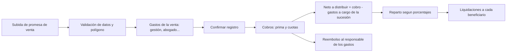

# 04.3 - Plan: Sucesión, Beneficiarios y Gastos de Venta

Plan de trabajo aprobado el 2026-09-27 e implementado a continuación. Surge del pedido del 2026-09-27:

1. Borrar el proyecto actual ("Proyecto principal", creado automáticamente al registrar la primera promesa).
2. Crear el proyecto **Sucesión Lino Marín**, con sede en **El Carmen, La Unión**.
3. Registrar a los **7 beneficiarios** (dueños de los terrenos), que reciben su parte de las ventas (porcentajes editables).
4. Nuevo módulo de **gastos de venta** (gestión de venta, abogados…) **amarrados a la venta de un lote** y capturados desde la **subida del documento de la promesa de venta**.

---

## 0. Decisiones (respondidas el 2026-09-27)

| # | Pregunta | Decisión |
| :--- | :--- | :--- |
| **B1** | ¿La Unión Norte o Sur? | ✅ **La Unión Sur** (coincide con la escritura). Ubicación: *El Carmen, La Unión Sur*. |
| **B2** | ¿Qué pasa con el terreno ya registrado? | ✅ **Se queda en Sucesión Lino Marín.** Se implementa editando "Proyecto principal" para convertirlo en la sucesión (mismo efecto que moverlo y borrar el proyecto vacío). |
| **B3** | ¿Se reparte el precio o lo cobrado? | ✅ **Lo cobrado:** cada cobro (prima o cuota) genera su reparto. |
| **B4** | ¿Cuándo se descuentan los gastos? | ✅ **Del primer pago, es decir, de la prima**, y ese dinero **se entrega a quien hizo los gastos de venta**. Cada gasto tiene un **responsable seleccionable** (uno de los beneficiarios u otra persona). Si la prima no alcanza, el saldo sale de las cuotas siguientes. |
| **B5** | ¿Se registran los gastos que paga el comprador? | Sin respuesta: se aplica la propuesta. Campo **"a cargo de"**: `SUCESIÓN` (se reembolsa al responsable y se descuenta del reparto) o `COMPRADOR` (solo control). |
| **B6** | ¿Siempre partes iguales? | ✅ **No.** Porcentajes editables que deben sumar 100 %; botón para repartir en partes iguales. |
| **B7** | ¿Control de entregas a beneficiarios? | ✅ **Sí:** registro de entregas (liquidaciones) y saldo pendiente por persona. |
| **B8** | Datos del beneficiario | Propuesta aplicada: nombre, DUI, teléfono y cuenta bancaria opcional. |
| **B9** | Vendedor en los contratos | Propuesta aplicada: el proyecto guarda el tipo de propietario (sucesión) y su representante. |
| **B10** | ¿Sobre `localStorage` o después de Dexie? | Propuesta aplicada: sobre el almacenamiento actual. |

## 1. Fase 8.1 — Gestión de proyectos (prerrequisito)

Hoy no se puede editar ni borrar un proyecto (`storage.ts` solo tiene `addProyecto`).

- [x] **8.1.1** `storage`: `updateProyecto`, `deleteProyecto` (bloquea si tiene lotes con contrato, salvo que se muevan) y `moverLotesAProyecto`. — S
- [x] **8.1.2** UI: en el menú de proyectos de la barra lateral, opciones **Editar** y **Eliminar** con confirmación. — S
- [x] **8.1.3** Tipo de propietario del proyecto: `PROPIO` o `SUCESION`, con nombre de la sucesión y representante (B9). — S
- [ ] **8.1.4** Acción de datos: crear **Sucesión Lino Marín** (El Carmen, La Unión Sur/Norte según B1, USD), mover o borrar el lote actual (B2) y eliminar "Proyecto principal". Se hace desde la interfaz nueva en tu navegador. — S

## 2. Fase 8.2 — Beneficiarios

- [x] **8.2.1** Modelo `Beneficiario`: `id`, `proyectoId`, `nombreCompleto`, `dui`, `telefono?`, `cuentaBancaria?`, `porcentaje`, `activo`, `createdAt`. — S
- [x] **8.2.2** Validación: los porcentajes activos del proyecto suman **100.00 %**; botón "Repartir en partes iguales" (7 × 14.2857 %). DUI con dígito verificador (RN-I3). — S
- [x] **8.2.3** Pantalla **Beneficiarios** dentro de la configuración del proyecto: alta, edición y baja lógica. — M
- [x] **8.2.4** Solo los proyectos de tipo `SUCESION` (o con beneficiarios) aplican reparto; un proyecto propio no cambia su comportamiento. — S

## 3. Fase 8.3 — Módulo de Gastos de Venta

- [x] **8.3.1** Modelo `GastoVenta`: `id`, `proyectoId`, `loteId`, `contratoId`, `categoria`, `descripcion`, `monto`, `fecha`, `aCargoDe` (`SUCESION` \| `COMPRADOR`), `proveedor` (p. ej. nombre del abogado), `referencia?`, `pagado` (sí/no), `createdAt`. — S
- [x] **8.3.2** Categorías iniciales: **Gestión / comisión de venta**, **Honorarios de abogado / notario**, **Escrituración**, **Levantamiento topográfico**, **Inscripción CNR**, **Solvencias e impuestos**, **Otros**. — S
- [x] **8.3.3** **Paso nuevo en la subida de la promesa** (Ingesta): después de validar datos y polígono, una sección *"Gastos de esta venta"* para agregar los gastos antes de confirmar. Se guardan amarrados al lote y al contrato creados. — M
- [x] **8.3.4** Nuevo módulo **"Gastos de Venta"** en la barra lateral: lista por lote con filtros (categoría, a cargo de, pagado), totales por venta y por proyecto, y opción de **agregar gastos después** (p. ej. honorarios al escriturar). — M
- [x] **8.3.5** En el panel del lote (mapa) y en Finanzas: resumen de gastos de esa venta. — S

## 4. Fase 8.4 — Reparto a beneficiarios

- [x] **8.4.1** Reglas **RN-B1 a RN-B4** en [[03.2 - Reglas de Negocio y Cálculos]] (ver sección 6). — S
- [x] **8.4.2** Registrar la **prima** como cobro al confirmar la promesa (hoy se da por pagada sin recibo), para que también se reparta. — M
- [x] **8.4.3** Al registrar cada cobro: calcular neto (cobro − gastos pendientes de descontar) y generar un **reparto** por beneficiario. — M
- [x] **8.4.4** Modelo `Reparto`: `id`, `reciboId`, `beneficiarioId`, `monto`, `fecha`; y `Liquidacion`: `id`, `beneficiarioId`, `monto`, `fecha`, `metodo`, `referencia?` (pago efectivo al heredero). — S
- [ ] **8.4.5** Anular un cobro anula su reparto (coherente con RN-C4). — S
- [x] **8.4.6** Pruebas automáticas con los ejemplos de la sección 6. — S

## 5. Fase 8.5 — Reportes y tablero

- [x] **8.5.1** Estado por beneficiario: total repartido, liquidado y **pendiente de entregar**. — M
- [x] **8.5.2** Estado por venta: precio, cobrado, gastos (sucesión / comprador), neto repartido. — S
- [x] **8.5.3** Comprobante imprimible de **liquidación** a un beneficiario. — S
- [x] **8.5.4** Tablero: tarjetas de "Gastos del mes" y "Pendiente de liquidar a beneficiarios". — S

## 6. Reglas propuestas (se pasarán a 03.2 tras la revisión)

- **RN-B1 · Base del reparto:** cada cobro registrado (prima o cuota) de un lote de un proyecto con beneficiarios.
- **RN-B2 · Gastos:** los gastos `aCargoDe = SUCESION` de esa venta se descuentan del primer cobro (normalmente la prima) y, si no alcanzan, de los siguientes hasta cubrirse. Los gastos a cargo del comprador no afectan el reparto.
- **RN-B3 · Partes:** neto × porcentaje de cada beneficiario activo, redondeado **hacia abajo** al centavo; los centavos sobrantes se asignan uno a uno **en rotación** (empezando por el beneficiario siguiente al que recibió el último centavo), para que a la larga nadie gane ni pierda.
- **RN-B4 · Cambios de porcentaje:** afectan solo a los cobros futuros; los repartos hechos no se recalculan.

**Ejemplo (cifras ficticias):** venta de $20,000.00 con prima de $5,000.00 y 12 cuotas de $1,250.00; gastos a cargo de la sucesión: gestión de venta $600.00 y abogado $400.00. La escrituración, a cargo del comprador, no se descuenta.

| Cobro | Monto | Gastos descontados | Neto | Por beneficiario (7) |
| :--- | ---: | ---: | ---: | :--- |
| Prima | 5,000.00 | 1,000.00 | 4,000.00 | Beneficiarios 1–6: 571.43 · beneficiario 7: 571.42 |
| Cuota 1 | 1,250.00 | 0.00 | 1,250.00 | Beneficiario 7: 178.58 (le toca el centavo en la rotación) · resto: 178.57 |
| Cuota 2 | 1,250.00 | 0.00 | 1,250.00 | Beneficiario 1: 178.58 · resto: 178.57 |

## 7. Fase 8.6 — Documentación

- [x] **8.6.1** Nota nueva **02.7 - Beneficiarios y Gastos de Venta**. — S
- [x] **8.6.2** 03.1: entidades `Beneficiario`, `GastoVenta`, `Reparto`, `Liquidacion` y campos nuevos de `Proyecto`. — S
- [x] **8.6.3** 03.2: reglas RN-B1 a RN-B4 y RN-GV (gastos). — S
- [x] **8.6.4** ADR-011 con las decisiones B3, B4 y B10. — S
- [x] **8.6.5** Glosario: sucesión, beneficiario, reparto, liquidación, gasto de venta. — S

---

> [!SUCCESS] Implementado el 2026-09-27
> - Proyectos editables y eliminables (con traslado de lotes); tipo **Sucesión** con representante.
> - Módulos nuevos **Beneficiarios** y **Gastos de Venta**; sección *Gastos de esta Venta* en la ingesta; gastos en el panel del lote; resumen en el tablero.
> - Reparto automático de la prima y de cada cuota, con reembolso al responsable, rotación de centavos, cobros sin repartir, saldos, entregas y comprobante imprimible.
> - Pruebas: 10 nuevas del motor de reparto (49 en total). Verificado en el navegador con datos ficticios.
> - **Pendiente:**
>   - 8.1.4, acción de datos del administrador en su navegador: editar "Proyecto principal" → nombre *Sucesión Lino Marín*, ubicación *El Carmen, La Unión Sur*, propietario *Sucesión*; luego cargar los 7 beneficiarios y los gastos, y repartir la prima pendiente.
>   - 8.4.5: anular un cobro no anula su reparto, porque el modelo v1 no tiene anulación de pagos.
> - Corrección adicional: `formatDate` mostraba el día anterior en El Salvador (RN-F4).

## 8. Fase 8.7 — Negociaciones previas a la venta (2026-09-28)

Pedido: registrar negociaciones (p. ej. con un interesado) y sus gastos antes de que exista la venta; al marcarla completada queda esperando la promesa, y al subir la promesa se convierte en venta.

| # | Decisión | Respuesta |
| :--- | :--- | :--- |
| **N1** | Si la negociación se cae, ¿quién asume los gastos? | ✅ **Se decide al cancelar:** la sucesión (próxima prima) o quien los hizo. |
| **N2** | ¿Lote específico? | ✅ **Opcional** (lote existente o descripción libre). |
| **N3** | ¿Reservar el lote al completarla? | ✅ **Sí**; se libera al cancelar o reabrir. |
| **N4** | ¿Dónde? | ✅ **Módulo propio** "Negociaciones". |

- [x] **8.7.1** Modelo `Negociacion`; gastos con `negociacionId`, sin venta; `aCargoDe = RESPONSABLE`; categorías combustible y viáticos. — S
- [x] **8.7.2** Storage: crear, editar, completar (reserva), reabrir, cancelar (decide quién asume) y conversión al registrar la promesa. — M
- [x] **8.7.3** Motor: la prima también reembolsa gastos de negociaciones canceladas asumidos por la sucesión (RN-N3), con prueba. — S
- [x] **8.7.4** Módulo **Negociaciones**: tablero por estado, detalle con gastos, alta y cancelación. — M
- [x] **8.7.5** Ingesta vinculada ("Subir promesa" o selector) con datos precargados y resumen de gastos a reembolsar. — S
- [x] **8.7.6** Avisos: contador en la barra lateral, tablero y módulo; origen en Gastos de Venta. — S
- [x] **8.7.7** Documentación: ADR-012, 02.7 §6, 03.1, 03.2 (RN-N1 a RN-N4), glosario. — S

> [!SUCCESS] Verificado en el navegador con datos ficticios (2026-09-28)
> - **Negociación convertida:** gastos de $40 + $25 → completada (lote reservado, contador y avisos) → "Subir promesa" con datos precargados → venta registrada. La prima reembolsó $65 y el lote quedó vendido.
> - **Canceladas:** $30 asumidos por la sucesión se reembolsaron con la siguiente prima; $20 asumidos por quien los hizo, no.

## 9. Fase 8.8 — Perfeccionamiento de procesos y documentos (2026-09-30)

Pedido: perfeccionar beneficiarios, gastos, reparto, negociaciones, motor financiero y el contenido de los documentos (formato recibo), **sin tocar el diseño**: la interfaz queda a cargo de Gemini ([[04.4 - Indicaciones para Gemini (Frontend)]]).

- [x] **8.8.1** Motor financiero: redondeo en centavos (RN-F3) y fechas sin zona horaria con día de corte 29–31 (RN-F4). Reproduce al centavo las tablas de 03.2. Cierra 6.5 y 6.8 del plan 04.2.
- [x] **8.8.2** Cobros: pagos parciales y pagos que cubren varias cuotas (RN-C1 sin recargos), con desglose interés/capital guardado en el recibo; rechazo si superan lo pendiente.
- [x] **8.8.3** Anulación del último cobro vigente (RN-C4): revierte cuotas y anula su reparto; los saldos pueden quedar negativos ("a devolver").
- [x] **8.8.4** Folios por proyecto y año (D5): `SLM-2026-0001` y `SLM-ENT-2026-0001` para entregas.
- [x] **8.8.5** Recibo de prima al registrar la promesa (y emitido automáticamente para ventas anteriores).
- [x] **8.8.6** Beneficiarios: normalización, DUI válido y sin duplicados, y no se elimina a quien tiene repartos, gastos, entregas o negociaciones.
- [x] **8.8.7** Gastos: validación (monto, fecha, responsable del proyecto), normalización y edición mientras no se reembolsen; los de la ingesta también se validan.
- [x] **8.8.8** Reparto y entregas: "repartir todos" en orden, entrega validada contra lo pendiente, "entregar a todos".
- [x] **8.8.9** Negociaciones: solo se convierte una negociación abierta o en espera.
- [x] **8.8.10** Documentos: monto en letras ("UN MIL CIENTO VEINTICINCO 00/100 DÓLARES…"), recibo de prima, recibo de cuotas y comprobante de entrega con formato de recibo (`src/shared/documentos/`), expuestos con `storage.getDocumentoRecibo()` y `getDocumentoEntrega()`.
- [x] **8.8.11** Pruebas: 116 (motor, pagos, reparto, documentos e integración de procesos).
- [ ] **8.8.12** Interfaz de todo lo anterior → Gemini ([[04.4 - Indicaciones para Gemini (Frontend)]]).

## Orden sugerido

| Paso | Trabajo | Depende de |
| :--- | :--- | :--- |
| 1 | Revisar y responder B1–B10 | — |
| 2 | 8.1 Gestión de proyectos + crear la sucesión y mover/borrar el lote | B1, B2, B9 |
| 3 | 8.2 Beneficiarios | B6, B8 |
| 4 | 8.3 Gastos de venta (paso en la ingesta + módulo) | B5 |
| 5 | 8.4 Reparto + pruebas | B3, B4 |
| 6 | 8.5 Reportes y 8.6 Documentación | 8.4 |

Enlaces relacionados:
- [[04.2 - Plan de Corrección de Documentación]]
- [[02.1 - Ingesta y Procesamiento de Promesas de Venta]]
- [[02.5 - Clientes, Cobranza y Recibos]]
- [[03.1 - Esquema de Base de Datos y Entidades]]
- [[03.2 - Reglas de Negocio y Cálculos]]
